# Forest Plot Workflow

This vignette demonstrates the `pmxhelpr` forest plot workflow for
visualizing the univariate impact of covariate effects in a model on the
integrated model output (e.g. exposure metrics, response metrics, ratio
to reference)

The pipeline mirrors the
[VPC](https://ryancrass.github.io/pmxhelpr/articles/vpc-workflow.md) and
[dose-proportionality](https://ryancrass.github.io/pmxhelpr/articles/doseprop-workflow.md)
workflows. Where to start depends on the data in hand:

- **Wide simulation output** (one row per scenario per replicate,
  metrics as columns): reshape it with
  [`df_forest_preprocess()`](https://ryancrass.github.io/pmxhelpr/reference/df_forest_preprocess.md),
  then continue below.
- **Long simulation output** (one row per scenario per replicate per):
  call `plot_forest(draws, metric = )` for a single plot, or
  [`df_forest()`](https://ryancrass.github.io/pmxhelpr/reference/df_forest.md)
  once and pass its result to
  [`plot_forest()`](https://ryancrass.github.io/pmxhelpr/reference/plot_forest.md)
  for several metrics or layouts.
- **Summary output**: wrap it as a `forest_stats` object and call
  [`plot_build_forest()`](https://ryancrass.github.io/pmxhelpr/reference/plot_build_forest.md)
  (see “Building a `forest_stats` by hand” in
  [`?plot_build_forest`](https://ryancrass.github.io/pmxhelpr/reference/plot_build_forest.md)).

``` r

options(scipen = 999, rmarkdown.html_vignette.check_title = FALSE)
library(pmxhelpr)
library(dplyr, warn.conflicts =  FALSE)
library(ggplot2, warn.conflicts =  FALSE)
```

## Background

A univariate forest plot is a graphical model application used to
visualize the impact of intrinsic and extrinsic participant factors
(i.e., covariates) on integrated model outputs (e.g., exposure metrics,
response metrics, ratios of exposure or response) under test conditions
relative to reference conditions.

The typical workflow involves establishing the reference scenario (i.e.,
the vector of covariates at the reference level for each individual
covariate) and test scenarios, each differing in only one covariate
value from the reference scenario.

The model is then applied to generate predictions under each scenario
with uncertainty and/or variability arising from unique sets of fixed
effects model parameters in each simulation sampled from the uncertainty
in parameter estimation (i.e., sampled from a multivariate normal
distribution with the mean vector set to the vector of final fixed
effects parameter estimates).

The output from the simulation is a distribution of “typical” (fixed
effects only) model outputs, from which the median (50th percentile) is
interpreted as the estimate of central tendency and quantiles (e.g.,
2.5th-97.5th, 5th-95th) are interpreted as the confidence interval
around the central tendency (e.g., 95% CI, 90% CI)

The bioequivalence criteria (0.8 to 1.25) provide a conventional
reference range for interpretation of covariate impact on exposure.

## Data

This vignette uses two internal datasets built using the internal
`data_sad` dataset and the internal PK model (`pkmodel`).

- `data_sad_pkforest_sim`: raw exposure metric simulation output for N =
  500 replicates. Dosing of 200 mg once daily to steady state. Exposure
  metrics are summarized to one row per scenario (M) per replicate (N)
  resulting in a dataset of length M x N (6 scenarios \* 500 replicates
  = 3000). Example input dataset for
  [`df_forest_preprocess()`](https://ryancrass.github.io/pmxhelpr/reference/df_forest_preprocess.md)

``` r

glimpse(data_sad_pkforest_sim)
#> Rows: 3,000
#> Columns: 9
#> $ ID   <dbl> 1, 1, 1, 1, 1, 1, 1, 1, 1, 1, 1, 1, 1, 1, 1, 1, 1, 1, 1, 1, 1, 1,…
#> $ SIM  <dbl> 1, 2, 3, 4, 5, 6, 7, 8, 9, 10, 11, 12, 13, 14, 15, 16, 17, 18, 19…
#> $ WTBL <dbl> 70, 70, 70, 70, 70, 70, 70, 70, 70, 70, 70, 70, 70, 70, 70, 70, 7…
#> $ FOOD <dbl> 0, 0, 0, 0, 0, 0, 0, 0, 0, 0, 0, 0, 0, 0, 0, 0, 0, 0, 0, 0, 0, 0,…
#> $ DOSE <dbl> 200, 200, 200, 200, 200, 200, 200, 200, 200, 200, 200, 200, 200, …
#> $ CMAX <dbl> 844.8669, 822.4267, 868.3378, 773.0414, 913.1536, 612.5367, 1002.…
#> $ CMIN <dbl> 200.0502, 272.0832, 258.2627, 157.6926, 181.3835, 213.1723, 202.5…
#> $ AUC  <dbl> 12006.29, 13463.48, 13488.21, 10383.56, 12138.47, 10439.84, 12970…
#> $ CAVG <dbl> 500.2621, 560.9784, 562.0089, 432.6482, 505.7697, 434.9935, 540.4…
```

- `data_sad_pkforest`: pre-processed simulated exposure metrics.
  Exposure metrics are gathered from columns into rows, one row per
  scenario (M) per replicate (N) per metric (K), resulting in a dataset
  of length M x N x K (6 scenarios \* 500 replicates \* 8 metrics =
  24000). Example output dataset from `df_forest_preprocess` and example
  input dataset for
  [`df_forest()`](https://ryancrass.github.io/pmxhelpr/reference/df_forest.md).

``` r

glimpse(data_sad_pkforest) 
#> Rows: 24,000
#> Columns: 9
#> $ ID        <dbl> 1, 1, 1, 1, 1, 1, 1, 1, 1, 1, 1, 1, 1, 1, 1, 1, 1, 1, 1, 1, …
#> $ SIM       <dbl> 1, 1, 1, 1, 1, 1, 1, 1, 2, 2, 2, 2, 2, 2, 2, 2, 3, 3, 3, 3, …
#> $ WTBL      <dbl> 70, 70, 70, 70, 70, 70, 70, 70, 70, 70, 70, 70, 70, 70, 70, …
#> $ FOOD      <dbl> 0, 0, 0, 0, 0, 0, 0, 0, 0, 0, 0, 0, 0, 0, 0, 0, 0, 0, 0, 0, …
#> $ DOSE      <dbl> 200, 200, 200, 200, 200, 200, 200, 200, 200, 200, 200, 200, …
#> $ metric    <chr> "CMAX", "CMIN", "AUC", "CAVG", "CMAXRATIO", "CMINRATIO", "AU…
#> $ value     <dbl> 844.8669, 200.0502, 12006.2897, 500.2621, 1.0000, 1.0000, 1.…
#> $ cov_name  <chr> "Reference", "Reference", "Reference", "Reference", "Referen…
#> $ cov_level <chr> "Reference", "Reference", "Reference", "Reference", "Referen…
```

Relevant variables in these datasets include: + `ID` identifies the
scenarios (1 = reference, 2 = fed, 3 = 50 kg, 4 = 60 kg, 5 = 80 kg, 6 =
90 kg) + `SIM` is the replicate counter + `metric` holds the the
exposure metric names, which include both absolute (`CMAX`, `CMIN`,
`AUC`, `CAVG`) and test/reference ratios (`CMAXRATIO`, `CMINRATIO`,
`AUCRATIO`, `CAVGRATIO`) + `value` holds the exposure metric values +
`cov_name` holds the name of the univariate covariate varied
(`Reference`, `FOOD`, `WTBL`) + `cov_level` holds the level label of the
univariate covariate varied (`Reference`, `Fed`, `50 kg`, `60 kg`,
`80 kg`, `90 kg`)

It also carries a `cov_level_ref` attribute naming each covariate’s
reference.

## Preprocessing with `df_forest_preprocess()`

[`df_forest_preprocess()`](https://ryancrass.github.io/pmxhelpr/reference/df_forest_preprocess.md)
is the entry point from a simulation output to the forest plot pipeline.
It reads the scenario structure from the covariate columns in the raw
simulation output.

Key arguments are as follows:

- `data`: data.frame, simulation output dataset for processing
- `metric_vars`: character vector, names of metric variables in `data`
- `cov_vars`: character vector, names of covariate variables in `data`
- `cov_val_ref`: named vector, covariate name: reference value pairs
  defining the reference conditions
- `cov_labels`: list, covariate value:label pairs or labeling function

``` r

simsum <- df_forest_preprocess(
  data_sad_pkforest_sim,
  metric_vars   = c("CMAX", "CMIN", "AUC", "CAVG"),
  cov_vars      = c("FOOD", "WTBL"),
  cov_val_ref = c(FOOD = 0, WTBL = 70),
  cov_labels    = list(
    FOOD = c("0" = "Fasted", "1" = "Fed"),
    WTBL = function(x) paste(x, "kg")
  )
)
glimpse(simsum)
#> Rows: 24,000
#> Columns: 9
#> $ ID        <dbl> 1, 1, 1, 1, 1, 1, 1, 1, 1, 1, 1, 1, 1, 1, 1, 1, 1, 1, 1, 1, …
#> $ SIM       <dbl> 1, 1, 1, 1, 1, 1, 1, 1, 2, 2, 2, 2, 2, 2, 2, 2, 3, 3, 3, 3, …
#> $ WTBL      <dbl> 70, 70, 70, 70, 70, 70, 70, 70, 70, 70, 70, 70, 70, 70, 70, …
#> $ FOOD      <dbl> 0, 0, 0, 0, 0, 0, 0, 0, 0, 0, 0, 0, 0, 0, 0, 0, 0, 0, 0, 0, …
#> $ DOSE      <dbl> 200, 200, 200, 200, 200, 200, 200, 200, 200, 200, 200, 200, …
#> $ metric    <chr> "CMAX", "CMIN", "AUC", "CAVG", "CMAXRATIO", "CMINRATIO", "AU…
#> $ value     <dbl> 844.8669, 200.0502, 12006.2897, 500.2621, 1.0000, 1.0000, 1.…
#> $ cov_name  <chr> "Reference", "Reference", "Reference", "Reference", "Referen…
#> $ cov_level <chr> "Reference", "Reference", "Reference", "Reference", "Referen…
```

Every column that is not a metric passes through, so simulation inputs
such as `ID`, `WTBL`, `FOOD` and `DOSE` stay available for filtering and
faceting downstream.

This function call is exactly how the shipped dataset
`data_sad_pkforest` is built, so the two are the same frame. The rest of
the vignette works from `simsum` to follow the workflow which would be
used in a real worked forest plot workflow.

``` r

identical(simsum, data_sad_pkforest)
#> [1] TRUE
```

Each covariate’s reference label is attached as an attribute, ready to
pass to
[`df_forest()`](https://ryancrass.github.io/pmxhelpr/reference/df_forest.md)
as `cov_level_ref`.

``` r

ref_levels <- attr(simsum, "cov_level_ref")
ref_levels
#>     FOOD     WTBL 
#> "Fasted"  "70 kg"
```

### Reference Conditions

The reference condition is defined by the `cov_val_ref` argument, which
takes a vector of covariate name:reference value pairs.
[`df_forest_preprocess()`](https://ryancrass.github.io/pmxhelpr/reference/df_forest_preprocess.md)
labels `cov_name` and `cov_level` as `"Reference"` (the `cov_name_ref`
argument) in the rows of the dataset with the reference values of every
covariate.

``` r

ref <- filter(simsum, cov_name == "Reference")
unique(ref$cov_name)
#> [1] "Reference"
unique(ref$cov_level)
#> [1] "Reference"
unique(ref$FOOD)
#> [1] 0
unique(ref$WTBL)
#> [1] 70
```

Every other scenario must differ from the reference in a univariate
manner (i.e., by exactly one covariate value), and that covariate
becomes the rows `cov_name`, with its labeled value as `cov_level`. No
scenario identifier column or separate lookup table is needed, as the
covariate combination in the dataset defines the scenario.

Matching is on the character form of the value, so a numeric column and
a character reference value still line up. A scenario that varies two
covariates at once has no single covariate to attribute the change to,
so it aborts. Factorial designs are out of scope.

``` r

factorial_sim <- data_sad_pkforest_sim
factorial_sim$FOOD[factorial_sim$ID == 6] <- 1   # 90 kg *and* fed

df_forest_preprocess(
  factorial_sim,
  metric_vars   = "AUC",
  cov_vars      = c("FOOD", "WTBL"),
  cov_val_ref = c(FOOD = 0, WTBL = 70)
)
#> Error in `df_forest_preprocess()`:
#> ! every non-reference scenario must differ from the reference in exactly one covariate; these differ in more than one: FOOD = 1, WTBL = 90. `df_forest_preprocess()` does not support factorial scenario designs.
```

### Ratios

Test-to-Reference ratios are derived automatically for each metric
producing a within-replicate test/reference ratio named
`<metric><ratio_suffix>`.

Because the parameter set is shared across scenarios within a replicate,
uncertainty common to both test and reference cancels in the ratio.

`ratio = FALSE` emits the absolute metrics alone, and `ratio_suffix`
renames the ratio metrics.

``` r

df_forest_preprocess(
  data_sad_pkforest_sim,
  metric_vars   = "AUC",
  cov_vars      = c("FOOD", "WTBL"),
  cov_val_ref = c(FOOD = 0, WTBL = 70),
  ratio_suffix  = "RAT"
) %>%
  distinct(metric)
#>   metric
#> 1    AUC
#> 2 AUCRAT
```

### Labels

`cov_labels` accepts a list of key:value pairs to define labels for each
covariate, one entry per covariate, or a labeling function applied to
the values. A value with no label falls back to its character form with
a warning, which is what happens below for the fed level.

``` r

df_forest_preprocess(
  data_sad_pkforest_sim,
  metric_vars   = "AUC",
  cov_vars      = c("FOOD", "WTBL"),
  cov_val_ref = c(FOOD = 0, WTBL = 70),
  cov_labels    = list(FOOD = c("0" = "Fasted"))
) %>%
  distinct(cov_name, cov_level)
#> Warning: `cov_labels` has no entry for these covariate values: FOOD = 1. They
#> are labeled by their character value.
#>    cov_name cov_level
#> 1 Reference Reference
#> 2      FOOD         1
#> 3      WTBL        50
#> 4      WTBL        60
#> 5      WTBL        80
#> 6      WTBL        90
```

## Computing summary statistics with `df_forest()`

[`df_forest()`](https://ryancrass.github.io/pmxhelpr/reference/df_forest.md)
is the summary function which produces a class tagged object ready for
rendering as a forest plot.

The only required argument is `data`. The column-name arguments default
to the conventions
[`df_forest_preprocess()`](https://ryancrass.github.io/pmxhelpr/reference/df_forest_preprocess.md)
emits:

- `metric_name_var`: column of metric names, default `metric`
- `metric_value_var`: column of metric values, default `value`
- `cov_name_var`: column of covariate names, default `cov_name`
- `cov_level_var`: column of covariate levels, default `cov_level`

Every row of a `(metric, covariate, level)` group is aggregated, so no
replicate index column (e.g., `SIM`) is needed.

``` r

forest_obj <- df_forest(simsum)
forest_obj
#> <forest_stats>
#>   stats: 48 rows x 13 columns
#>   config: metric_name_var = metric, metric_value_var = value, cov_name_var = cov_name, cov_level_var = cov_level, ci = 0.9, sigdigits = 3, cov_name_ref = Reference, cov_level_ref = NULL
#> 
#>   head(stats, 3):
#>   metric  cov_name cov_level       est        lo       hi   n est_label
#> 1   CMAX Reference Reference  861.3751  741.2410 1005.205 500       861
#> 2   CMAX      FOOD       Fed 1465.1054 1180.1763 1830.221 500      1465
#> 3   CMAX      WTBL     50 kg 1118.5361  936.4438 1306.034 500      1119
#>   lo_label hi_label          ci_label is_ref       layout
#> 1      741     1005   861 (741, 1005)   TRUE consolidated
#> 2     1180     1830 1465 (1180, 1830)  FALSE         both
#> 3      936     1306  1119 (936, 1306)  FALSE         both
#> 
#>   Use `x$stats` for the full data.frame.
```

The `stats` slot holds one row per plotted point, in plotting order:
`est`, `lo`, and `hi`, their formatted labels (`ci_label` combines them
for tables), the draw count `n`, `is_ref` for the reference rows, and
`layout` (see [Where the reference row is
drawn](#where-the-reference-row-is-drawn)). Edit `est_label`,
`lo_label`, or `hi_label` to change the plotted text.

``` r

forest_obj$stats
#>       metric  cov_name cov_level           est            lo            hi   n
#> 1       CMAX Reference Reference   861.3750994   741.2410080  1005.2045867 500
#> 2       CMAX      FOOD       Fed  1465.1054176  1180.1762553  1830.2213691 500
#> 3       CMAX      WTBL     50 kg  1118.5361190   936.4437765  1306.0338117 500
#> 4       CMAX      WTBL     60 kg   971.2402766   824.2664189  1129.1458559 500
#> 5       CMAX      WTBL     80 kg   776.4423820   669.8907596   916.7885283 500
#> 6       CMAX      WTBL     90 kg   708.0895493   608.5112952   841.5354644 500
#> 7       CMIN Reference Reference   219.0686436   157.6645590   287.2615988 500
#> 8       CMIN      FOOD       Fed   818.1375026   573.4613217  1128.5121716 500
#> 9       CMIN      WTBL     50 kg   269.1555134   187.3158389   375.0697115 500
#> 10      CMIN      WTBL     60 kg   241.3125053   172.7303956   327.6239892 500
#> 11      CMIN      WTBL     80 kg   200.8846609   143.8317810   261.7982474 500
#> 12      CMIN      WTBL     90 kg   185.3940547   135.0522034   249.6487099 500
#> 13       AUC Reference Reference 12540.1499642 10481.3622800 14629.1085550 500
#> 14       AUC      FOOD       Fed 28815.2687976 23413.5097890 35996.7028666 500
#> 15       AUC      WTBL     50 kg 16187.3034385 13481.2322820 19372.8077113 500
#> 16       AUC      WTBL     60 kg 14110.3919678 11835.1395435 16475.0464049 500
#> 17       AUC      WTBL     80 kg 11328.0537406  9468.8424024 13333.9102429 500
#> 18       AUC      WTBL     90 kg 10337.0855959  8685.3364436 12300.9044300 500
#> 19      CAVG Reference Reference   522.5062485   436.7234283   609.5461898 500
#> 20      CAVG      FOOD       Fed  1200.6361999   975.5629079  1499.8626194 500
#> 21      CAVG      WTBL     50 kg   674.4709766   561.7180118   807.2003213 500
#> 22      CAVG      WTBL     60 kg   587.9329987   493.1308143   686.4602669 500
#> 23      CAVG      WTBL     80 kg   472.0022392   394.5351001   555.5795935 500
#> 24      CAVG      WTBL     90 kg   430.7118998   361.8890185   512.5376846 500
#> 25 CMAXRATIO Reference Reference     1.0000000     1.0000000     1.0000000 500
#> 26 CMAXRATIO      FOOD       Fed     1.7029977     1.4446801     2.0214743 500
#> 27 CMAXRATIO      WTBL     50 kg     1.2976226     1.2166269     1.3887267 500
#> 28 CMAXRATIO      WTBL     60 kg     1.1265144     1.0938047     1.1622069 500
#> 29 CMAXRATIO      WTBL     80 kg     0.9019662     0.8779759     0.9253633 500
#> 30 CMAXRATIO      WTBL     90 kg     0.8234991     0.7828402     0.8642331 500
#> 31 CMINRATIO Reference Reference     1.0000000     1.0000000     1.0000000 500
#> 32 CMINRATIO      FOOD       Fed     3.8487735     2.8681897     4.9713206 500
#> 33 CMINRATIO      WTBL     50 kg     1.2426439     1.0660589     1.4360467 500
#> 34 CMINRATIO      WTBL     60 kg     1.1051264     1.0304508     1.1806703 500
#> 35 CMINRATIO      WTBL     80 kg     0.9164507     0.8656326     0.9727320 500
#> 36 CMINRATIO      WTBL     90 kg     0.8481978     0.7619381     0.9482848 500
#> 37  AUCRATIO Reference Reference     1.0000000     1.0000000     1.0000000 500
#> 38  AUCRATIO      FOOD       Fed     2.3164392     2.0044530     2.6485638 500
#> 39  AUCRATIO      WTBL     50 kg     1.2916101     1.1870389     1.4069578 500
#> 40  AUCRATIO      WTBL     60 kg     1.1243808     1.0817207     1.1693195 500
#> 41  AUCRATIO      WTBL     80 kg     0.9034349     0.8732801     0.9342181 500
#> 42  AUCRATIO      WTBL     90 kg     0.8260290     0.7749029     0.8797958 500
#> 43 CAVGRATIO Reference Reference     1.0000000     1.0000000     1.0000000 500
#> 44 CAVGRATIO      FOOD       Fed     2.3164392     2.0044530     2.6485638 500
#> 45 CAVGRATIO      WTBL     50 kg     1.2916101     1.1870389     1.4069578 500
#> 46 CAVGRATIO      WTBL     60 kg     1.1243808     1.0817207     1.1693195 500
#> 47 CAVGRATIO      WTBL     80 kg     0.9034349     0.8732801     0.9342181 500
#> 48 CAVGRATIO      WTBL     90 kg     0.8260290     0.7749029     0.8797958 500
#>    est_label lo_label hi_label             ci_label is_ref       layout
#> 1        861      741     1005      861 (741, 1005)   TRUE consolidated
#> 2       1465     1180     1830    1465 (1180, 1830)  FALSE         both
#> 3       1119      936     1306     1119 (936, 1306)  FALSE         both
#> 4        971      824     1129      971 (824, 1129)  FALSE         both
#> 5        776      670      917       776 (670, 917)  FALSE         both
#> 6        708      609      842       708 (609, 842)  FALSE         both
#> 7        219      158      287       219 (158, 287)   TRUE consolidated
#> 8        818      573     1129      818 (573, 1129)  FALSE         both
#> 9        269      187      375       269 (187, 375)  FALSE         both
#> 10       241      173      328       241 (173, 328)  FALSE         both
#> 11       201      144      262       201 (144, 262)  FALSE         both
#> 12       185      135      250       185 (135, 250)  FALSE         both
#> 13     12500    10500    14600 12500 (10500, 14600)   TRUE consolidated
#> 14     28800    23400    36000 28800 (23400, 36000)  FALSE         both
#> 15     16200    13500    19400 16200 (13500, 19400)  FALSE         both
#> 16     14100    11800    16500 14100 (11800, 16500)  FALSE         both
#> 17     11300     9500    13300  11300 (9500, 13300)  FALSE         both
#> 18     10300     8700    12300  10300 (8700, 12300)  FALSE         both
#> 19       523      437      610       523 (437, 610)   TRUE consolidated
#> 20      1201      976     1500     1201 (976, 1500)  FALSE         both
#> 21       674      562      807       674 (562, 807)  FALSE         both
#> 22       588      493      686       588 (493, 686)  FALSE         both
#> 23       472      395      556       472 (395, 556)  FALSE         both
#> 24       431      362      513       431 (362, 513)  FALSE         both
#> 25      1.00     1.00     1.00    1.00 (1.00, 1.00)   TRUE consolidated
#> 26      1.70     1.44     2.02    1.70 (1.44, 2.02)  FALSE         both
#> 27      1.30     1.22     1.39    1.30 (1.22, 1.39)  FALSE         both
#> 28      1.13     1.09     1.16    1.13 (1.09, 1.16)  FALSE         both
#> 29      0.90     0.88     0.93    0.90 (0.88, 0.93)  FALSE         both
#> 30      0.82     0.78     0.86    0.82 (0.78, 0.86)  FALSE         both
#> 31      1.00     1.00     1.00    1.00 (1.00, 1.00)   TRUE consolidated
#> 32      3.85     2.87     4.97    3.85 (2.87, 4.97)  FALSE         both
#> 33      1.24     1.07     1.44    1.24 (1.07, 1.44)  FALSE         both
#> 34      1.11     1.03     1.18    1.11 (1.03, 1.18)  FALSE         both
#> 35      0.92     0.87     0.97    0.92 (0.87, 0.97)  FALSE         both
#> 36      0.85     0.76     0.95    0.85 (0.76, 0.95)  FALSE         both
#> 37      1.00     1.00     1.00    1.00 (1.00, 1.00)   TRUE consolidated
#> 38      2.32     2.00     2.65    2.32 (2.00, 2.65)  FALSE         both
#> 39      1.29     1.19     1.41    1.29 (1.19, 1.41)  FALSE         both
#> 40      1.12     1.08     1.17    1.12 (1.08, 1.17)  FALSE         both
#> 41      0.90     0.87     0.93    0.90 (0.87, 0.93)  FALSE         both
#> 42      0.83     0.77     0.88    0.83 (0.77, 0.88)  FALSE         both
#> 43      1.00     1.00     1.00    1.00 (1.00, 1.00)   TRUE consolidated
#> 44      2.32     2.00     2.65    2.32 (2.00, 2.65)  FALSE         both
#> 45      1.29     1.19     1.41    1.29 (1.19, 1.41)  FALSE         both
#> 46      1.12     1.08     1.17    1.12 (1.08, 1.17)  FALSE         both
#> 47      0.90     0.87     0.93    0.90 (0.87, 0.93)  FALSE         both
#> 48      0.83     0.77     0.88    0.83 (0.77, 0.88)  FALSE         both
```

### Adjusting the summary statistics

The summary can be customized with:

- `ci`: confidence interval to return, default `0.9` based on the
  interval recommended for bioequivalence assessment.
- `sigdigits`: number of significant digits in the label columns,
  default `3`. Digits are counted on the median estimate of each metric,
  so every value of a metric shares one count of decimal places (`0.90`
  and `2.32` for a ratio).

``` r

df_forest(simsum, ci = 0.95, sigdigits = 2)
#> <forest_stats>
#>   stats: 48 rows x 13 columns
#>   config: metric_name_var = metric, metric_value_var = value, cov_name_var = cov_name, cov_level_var = cov_level, ci = 0.95, sigdigits = 2, cov_name_ref = Reference, cov_level_ref = NULL
#> 
#>   head(stats, 3):
#>   metric  cov_name cov_level       est        lo       hi   n est_label
#> 1   CMAX Reference Reference  861.3751  717.3157 1036.208 500       860
#> 2   CMAX      FOOD       Fed 1465.1054 1133.0620 1878.886 500      1470
#> 3   CMAX      WTBL     50 kg 1118.5361  910.1290 1366.828 500      1120
#>   lo_label hi_label          ci_label is_ref       layout
#> 1      720     1040   860 (720, 1040)   TRUE consolidated
#> 2     1130     1880 1470 (1130, 1880)  FALSE         both
#> 3      910     1370  1120 (910, 1370)  FALSE         both
#> 
#>   Use `x$stats` for the full data.frame.
```

### Reference

Reference rows are identified by `cov_name_ref`, the value of `cov_name`
that marks the reference condition. The default `"Reference"` matches
the
[`df_forest_preprocess()`](https://ryancrass.github.io/pmxhelpr/reference/df_forest_preprocess.md)
output, but the reference can be called anything, as in the example
below. Reference rows are flagged `is_ref = TRUE` in the output, drawn
as an open circle, and sorted to the top of each metric (the reference
panel at the top of the plot).

``` r

renamed <- simsum %>%
  mutate(cov_level = ifelse(cov_name == "Reference", "70 kg, fasted", cov_level),
         cov_name = ifelse(cov_name == "Reference", "Typical subject", cov_name))
df_forest(renamed, cov_name_ref = "Typical subject")$stats %>%
  filter(metric == "AUCRATIO") %>%
  select(cov_name, cov_level, is_ref, ci_label)
#>          cov_name     cov_level is_ref          ci_label
#> 1 Typical subject 70 kg, fasted   TRUE 1.00 (1.00, 1.00)
#> 2            FOOD           Fed  FALSE 2.32 (2.00, 2.65)
#> 3            WTBL         50 kg  FALSE 1.29 (1.19, 1.41)
#> 4            WTBL         60 kg  FALSE 1.12 (1.08, 1.17)
#> 5            WTBL         80 kg  FALSE 0.90 (0.87, 0.93)
#> 6            WTBL         90 kg  FALSE 0.83 (0.77, 0.88)
```

`cov_level_ref` is a named vector mapping each covariate to its
reference level. When supplied, `$stats` also holds a copy of the
reference row in each named covariate panel, so the plot can draw the
reference there (see [Where the reference row is
drawn](#where-the-reference-row-is-drawn)).

``` r

forest_obj <- df_forest(simsum,
                        cov_level_ref = ref_levels)
forest_obj$stats %>%
  filter(metric == "AUCRATIO")
#>     metric  cov_name cov_level       est        lo        hi   n est_label
#> 1 AUCRATIO Reference Reference 1.0000000 1.0000000 1.0000000 500      1.00
#> 2 AUCRATIO      FOOD    Fasted 1.0000000 1.0000000 1.0000000 500      1.00
#> 3 AUCRATIO      FOOD       Fed 2.3164392 2.0044530 2.6485638 500      2.32
#> 4 AUCRATIO      WTBL     50 kg 1.2916101 1.1870389 1.4069578 500      1.29
#> 5 AUCRATIO      WTBL     60 kg 1.1243808 1.0817207 1.1693195 500      1.12
#> 6 AUCRATIO      WTBL     70 kg 1.0000000 1.0000000 1.0000000 500      1.00
#> 7 AUCRATIO      WTBL     80 kg 0.9034349 0.8732801 0.9342181 500      0.90
#> 8 AUCRATIO      WTBL     90 kg 0.8260290 0.7749029 0.8797958 500      0.83
#>   lo_label hi_label          ci_label is_ref       layout
#> 1     1.00     1.00 1.00 (1.00, 1.00)   TRUE consolidated
#> 2     1.00     1.00 1.00 (1.00, 1.00)   TRUE  distributed
#> 3     2.00     2.65 2.32 (2.00, 2.65)  FALSE         both
#> 4     1.19     1.41 1.29 (1.19, 1.41)  FALSE         both
#> 5     1.08     1.17 1.12 (1.08, 1.17)  FALSE         both
#> 6     1.00     1.00 1.00 (1.00, 1.00)   TRUE  distributed
#> 7     0.87     0.93 0.90 (0.87, 0.93)  FALSE         both
#> 8     0.77     0.88 0.83 (0.77, 0.88)  FALSE         both
```

If the data has no reference at all, pass `cov_name_ref = NULL`.

### Row order

Rows of `forest_obj$stats` are drawn in order top to bottom, and the
order is read from the input data rather than alphanumerically:

- Covariate name panels follow their factor levels when the input
  columns are factors, otherwise they order in order of first
  appearance.

- Covariate levels within a covariate follow the factor levels of the
  `cov_level_var` column when those levels cover every label, including
  a covariate’s reference label. Otherwise, if every label carries a
  distinct number, labels sort ascending by it (`50 kg` above `90 kg`,
  `-20%` above `-5%`). Any other set keeps the reference label on top,
  then data order.

To control the order explicitly:

- a priori set factor levels of `cov_level` before calling
  [`df_forest()`](https://ryancrass.github.io/pmxhelpr/reference/df_forest.md)
- a posteriori reorder the rows of `forest_obj$stats` before plotting.

The example below reorders the levels of the unique covariate values in
the pre-processed dataset output by `df_forest_preprocess` before
passing to `df_forest` to the desired order of descending body weights.

``` r

data_wt_desc <- simsum %>%
  mutate(cov_level = factor(cov_level, levels = c("Reference", "Fasted", "Fed",
                                              "90 kg", "80 kg", "70 kg", "60 kg", "50 kg")))

wt_desc <- df_forest(data_wt_desc, cov_level_ref = ref_levels)
wt_desc$stats %>%
  filter(metric == "AUCRATIO") %>%
  select(cov_name, cov_level, is_ref, layout, ci_label)
#>    cov_name cov_level is_ref       layout          ci_label
#> 1 Reference Reference   TRUE consolidated 1.00 (1.00, 1.00)
#> 2      FOOD    Fasted   TRUE  distributed 1.00 (1.00, 1.00)
#> 3      FOOD       Fed  FALSE         both 2.32 (2.00, 2.65)
#> 4      WTBL     90 kg  FALSE         both 0.83 (0.77, 0.88)
#> 5      WTBL     80 kg  FALSE         both 0.90 (0.87, 0.93)
#> 6      WTBL     70 kg   TRUE  distributed 1.00 (1.00, 1.00)
#> 7      WTBL     60 kg  FALSE         both 1.12 (1.08, 1.17)
#> 8      WTBL     50 kg  FALSE         both 1.29 (1.19, 1.41)
```

## Plotting with `plot_forest()`

[`plot_forest()`](https://ryancrass.github.io/pmxhelpr/reference/plot_forest.md)
is the top-level wrapper that bundles
[`df_forest()`](https://ryancrass.github.io/pmxhelpr/reference/df_forest.md)
and
[`plot_build_forest()`](https://ryancrass.github.io/pmxhelpr/reference/plot_build_forest.md).

It renders one metric per call specified by the `metric` argument. When
the input data carries only one metric, the `metric` argument does not
need to be specified and the metric is selected automatically.

The output is a `ggplot` object with one facet row per covariate, the
covariate level on the y-axis, and a right-hand estimate column
(`1.29 (1.19, 1.41)`) under a header built from `ci`
(e.g. `Estimate (90% CI)`). The rendered metric labels the x-axis; there
is no title by default.

``` r

plot_forest(simsum, metric = "AUCRATIO")
```

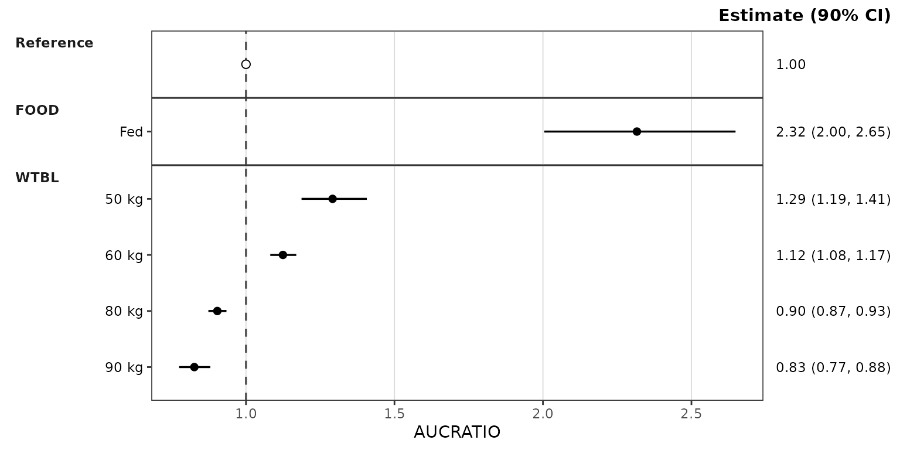

The vertical reference line defaults to `ref = "reference"`: the
reference row’s estimate (1 for a ratio, the reference exposure for a
raw metric). Pass a number to place it elsewhere, or `NULL` to suppress
it.

### Where the reference row is drawn

The plot above has no `cov_level_ref`, so the reference row sits in the
reference panel at the top. With `cov_level_ref`, the reference row is
drawn inside each covariate panel under its reference label instead, so
every panel shows the reference next to the varied levels:

``` r

plot_forest(simsum, metric = "AUCRATIO", cov_level_ref = ref_levels)
```

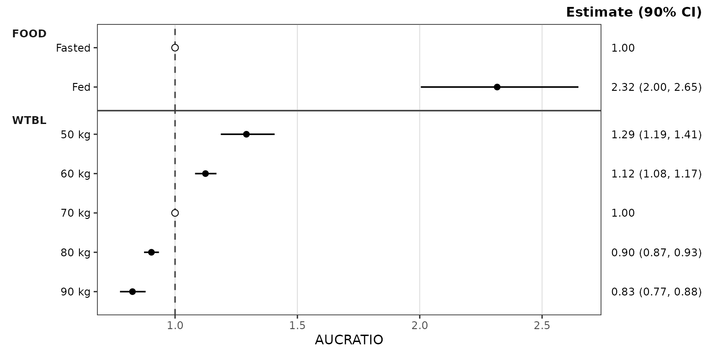

`ref_layout` switches between the two on the same summary without
re-aggregating: `"distributed"` (in each covariate panel, the default
when `cov_level_ref` is given) or `"consolidated"` (the reference
panel). The `layout` column of `$stats` records which rows each layout
draws.

### The equivalence band

`ref_band` is a numeric vector of length 2 specifying the bounds of a
shaded equivalence band. Its two values are read according to
`ref_band_type`:

- `"multiplicative"` (default): the band is `ref * ref_band`
- `"additive"`: the band is `ref + ref_band`
- `"absolute"`: the band is `ref_band`

A multiplicative band is symmetric only on a log axis, which can be
applied through the style with `style_forest(logx = TRUE)`, or by adding
[`scale_x_log10()`](https://ggplot2.tidyverse.org/reference/scale_continuous.html)
onto the returned `ggplot` object.

``` r

plot_forest(simsum, metric = "AUCRATIO",
            cov_level_ref = ref_levels,
            ref_band = c(0.8, 1.25),
            style = style_forest(logx = TRUE))
```

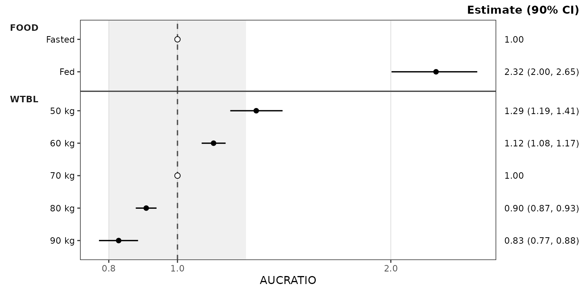 \## Absolute
exposure metrics

The same call works for an absolute metric. The reference line resolves
to the reference scenario’s exposure, and a multiplicative band of
`c(0.8, 1.25)` scales with it, so the plot reads the same way as the
ratio plot but on the exposure scale. The intervals are wider than for
the ratio.

``` r

plot_forest(simsum, metric = "AUC",
            cov_level_ref = ref_levels,
            ref_band = c(0.8, 1.25),
            style = style_forest(logx = TRUE))
```

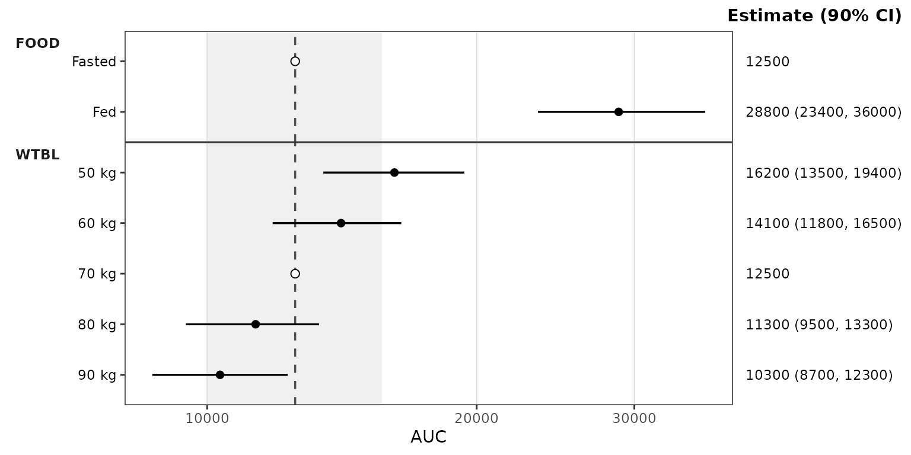

### Difference metrics

Metrics on an additive scale, such as percent change from the reference,
can be negative or zero, so they need a linear axis and an additive
band.

The example derives a percent-change metric from the ratio draws and
brackets the reference change of zero with the equivalent of the 0.8 to
1.25 bounds.

``` r

data_pchg <- simsum %>%
  filter(metric == "AUCRATIO") %>%
  mutate(metric = "AUCPCHG", value = 100 * (value - 1))

plot_forest(data_pchg,
            cov_level_ref = ref_levels,
            ref_band = c(-20, 25), ref_band_type = "additive")
```

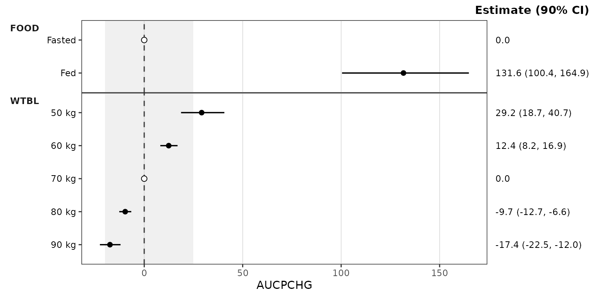

### The estimate column header

The header above the estimate column is built from `ci`
(`Estimate (90% CI)`). It is the plot subtitle, right-aligned so it sits
on the top edge of the panels, and can be relabelled after the fact with
`labs(subtitle = )`.

For a ratio metric the conventional label names the quantity rather than
the statistic, as in the example below

``` r

plot_forest(simsum, metric = "AUCRATIO",
            cov_level_ref = ref_levels,
            ref_band = c(0.8, 1.25),
            style = style_forest(logx = TRUE)) +
  labs(subtitle = "Ratio (90% CI)")
```

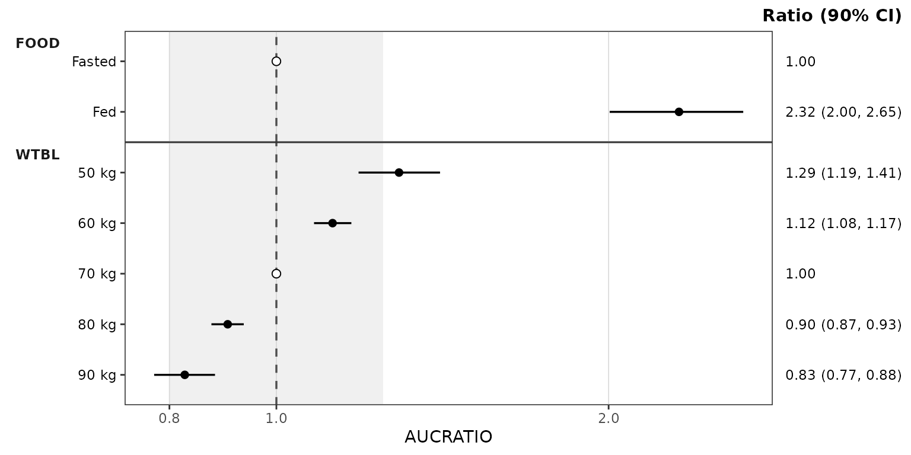

### Reusing precomputed stats

[`plot_forest()`](https://ryancrass.github.io/pmxhelpr/reference/plot_forest.md)
also accepts a `forest_stats` object directly. This skips the
aggregation and is the natural way to render several metrics from one
summary, or to try different `ref_band` and `style` settings on the same
data.

``` r

plot_forest(forest_obj, metric = "CMAXRATIO", ref_band = c(0.8, 1.25),
            style = style_forest(logx = TRUE))
```

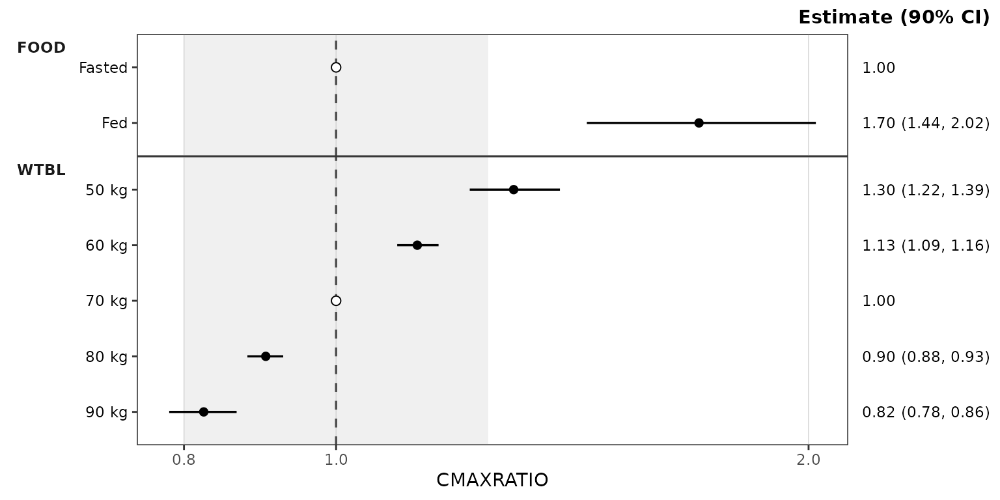

``` r


plot_forest(forest_obj, metric = "CMAX", ref_band = c(0.8, 1.25),
            style = style_forest(logx = TRUE))
```

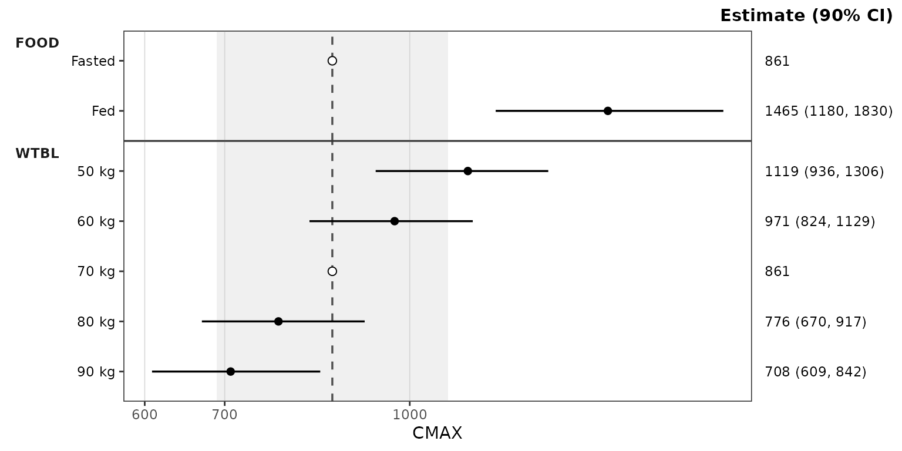

`forest_obj` was computed with `cov_level_ref`, so `ref_layout` can
switch it to the reference panel:

``` r

plot_forest(forest_obj, metric = "AUCRATIO", ref_layout = "consolidated",
            ref_band = c(0.8, 1.25), style = style_forest(logx = TRUE))
```

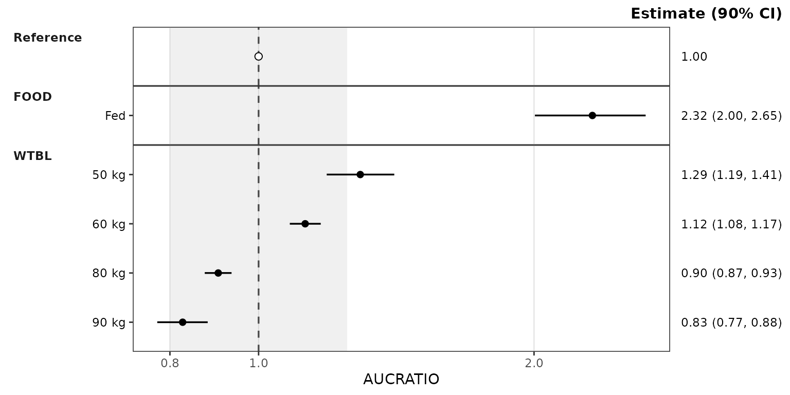

On a precomputed `forest_stats`, only the plot arguments (`metric`,
`ref`, `ref_band`, `ref_band_type`, `ref_layout`, `show_rep`, `style`)
are accepted; summary arguments such as `ci` abort with a pointer to
[`df_forest()`](https://ryancrass.github.io/pmxhelpr/reference/df_forest.md).

## Inspecting the `forest_stats` object

[`summary()`](https://rdrr.io/r/base/summary.html) prints the
configuration and one line per metric: its draw count and each
covariate’s levels in plot order, with reference copies drawn in a
covariate panel marked `*`.

``` r

summary(forest_obj)
#> <forest_stats>
#>   stats: 64 rows x 13 columns
#>   config: metric_name_var = metric, metric_value_var = value, cov_name_var = cov_name, cov_level_var = cov_level, ci = 0.9, sigdigits = 3, cov_name_ref = Reference, cov_level_ref = c(FOOD = "Fasted", WTBL = "70 kg")
#> 
#>   per metric:
#>     [CMAX]  n = 500  Reference | FOOD: Fasted*, Fed | WTBL: 50 kg, 60 kg, 70 kg*, 80 kg, 90 kg
#>     [CMIN]  n = 500  Reference | FOOD: Fasted*, Fed | WTBL: 50 kg, 60 kg, 70 kg*, 80 kg, 90 kg
#>     [AUC]  n = 500  Reference | FOOD: Fasted*, Fed | WTBL: 50 kg, 60 kg, 70 kg*, 80 kg, 90 kg
#>     [CAVG]  n = 500  Reference | FOOD: Fasted*, Fed | WTBL: 50 kg, 60 kg, 70 kg*, 80 kg, 90 kg
#>     [CMAXRATIO]  n = 500  Reference | FOOD: Fasted*, Fed | WTBL: 50 kg, 60 kg, 70 kg*, 80 kg, 90 kg
#>     [CMINRATIO]  n = 500  Reference | FOOD: Fasted*, Fed | WTBL: 50 kg, 60 kg, 70 kg*, 80 kg, 90 kg
#>     [AUCRATIO]  n = 500  Reference | FOOD: Fasted*, Fed | WTBL: 50 kg, 60 kg, 70 kg*, 80 kg, 90 kg
#>     [CAVGRATIO]  n = 500  Reference | FOOD: Fasted*, Fed | WTBL: 50 kg, 60 kg, 70 kg*, 80 kg, 90 kg
#>   * reference copy in a covariate panel (ref_layout = "distributed")
```

[`as.data.frame()`](https://rdrr.io/r/base/as.data.frame.html) returns
the `stats` slot as a plain `data.frame`, and
[`is_forest_stats()`](https://ryancrass.github.io/pmxhelpr/reference/is_forest_stats.md)
tests for the class (`strict = TRUE` also validates it).

## Styling

Plot aesthetics are customized via the `style` argument and the
[`style_forest()`](https://ryancrass.github.io/pmxhelpr/reference/style_forest.md)
preset, which returns a
[`ggstylekit::style_spec()`](https://rdrr.io/pkg/ggstylekit/man/style_spec.html).
The series roles are:

- `point` — the point estimate
- `errorbar` — the confidence interval line
- `ref_point` — the reference row’s estimate (an open circle by default)
- `ref_line` — the vertical reference line
- `ref_band` — the shaded equivalence band (`fill` and `alphas`)

``` r

style_forest()
#> <ggstylekit_style_spec>
#>   colors                 black , black , black , grey30
#>   fill                   white , grey80
#>   linetypes              solid , dashed
#>   alphas                 1.0, 1.0, 1.0, 1.0, 0.3
#>   shapes                 16, 21
#>   sizes                  2.2, 2.2
#>   linewidths             0.6, 0.6
#>   point_color            NULL
#>   point_alpha            NULL
#>   point_size             NULL
#>   point_shape            NULL
#>   line_color             NULL
#>   line_alpha             NULL
#>   line_linetype          NULL
#>   line_linewidth         NULL
#>   line_fill              NULL
#>   errorbar_color         NULL
#>   errorbar_alpha         NULL
#>   errorbar_linetype      NULL
#>   errorbar_linewidth     NULL
#>   errorbar_width         NULL
#>   errorbar_fill          NULL
#>   bar_fill               NULL
#>   bar_color              NULL
#>   bar_alpha              NULL
#>   bar_linewidth          NULL
#>   area_fill              NULL
#>   area_color             NULL
#>   area_alpha             NULL
#>   area_linewidth         NULL
#>   box_fill               NULL
#>   box_color              NULL
#>   box_alpha              NULL
#>   box_linewidth          NULL
#>   title                  NULL
#>   xlabel                 NULL
#>   ylabel                 NULL
#>   caption                NULL
#>   xlims                  NULL
#>   ylims                  NULL
#>   logx                   NULL
#>   logy                   NULL
#>   xbreaks                NULL
#>   ybreaks                NULL
#>   xminor_breaks          NULL
#>   yminor_breaks          NULL
#>   xtick_labels           NULL
#>   ytick_labels           NULL
#>   xorder                 NULL
#>   yorder                 NULL
#>   equal_axis             NULL
#>   legends                NULL
#>   legend.position        none
#>   legend.title.position  NULL
#>   legend_nrow            NULL
#>   legend_ncol            NULL
#>   legend.title.hjust     NULL
#>   caption_hjust          NULL
#>   fill_alpha             NULL
#>   facet                  NULL
#>   facet_scales           NULL
#>   facet_nrow             NULL
#>   facet_ncol             NULL
#>   theme                  <ggplot2 theme>
```

A typical override example is provided below using the style to change
the point sizes and the colors of the reference line and band:

``` r

plot_forest(forest_obj, metric = "AUCRATIO", ref_band = c(0.8, 1.25),
            style = style_forest(shapes = c(point = 18),
                                 sizes = c(point = 3),
                                 colors = c(ref_line = "firebrick"),
                                 fill = c(ref_band = "steelblue"),
                                 alphas = c(ref_band = 0.15),
                                 logx = TRUE))
```

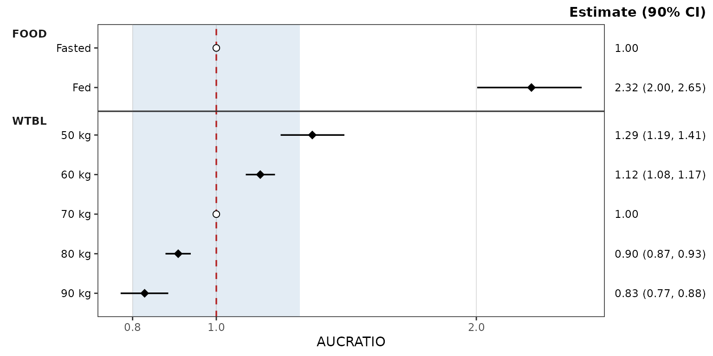

### Per-covariate coloring

Coloring by covariate is opt-in through the same `colors` map: add
entries keyed by covariate name.

When at least one plotted covariate is named, points and error bars are
colored by covariate and the legend is suppressed, since the panel
strips already label each covariate. Covariates without an entry take
colours from the house palette.

``` r

plot_forest(forest_obj, metric = "AUCRATIO", ref_band = c(0.8, 1.25),
            style = style_forest(colors = c(FOOD = "darkgreen", WTBL = "darkblue"),
                                 logx = TRUE))
```

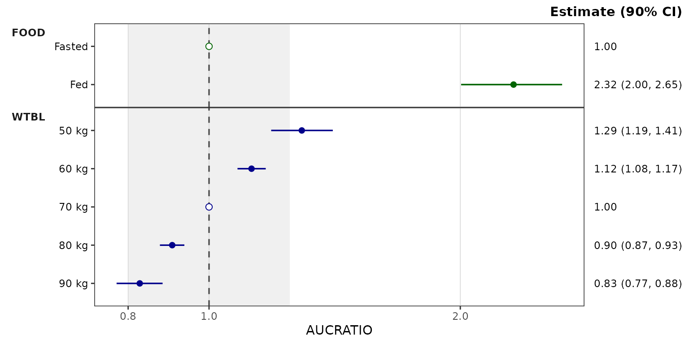

The facet layout is fixed by the renderer
([`facet_grid()`](https://ggplot2.tidyverse.org/reference/facet_grid.html)
rows by covariate, strips outside the y-axis), so the style’s `facet*`
fields are ignored.

The estimate column is right-hand axis text styled through the theme’s
`axis.text.y.right` element, and its header is the plot subtitle
(`plot.subtitle`). The x-axis label defaults to the metric and can be
replaced with the style’s `xlabel` field or `labs(x = )`; a title can be
added with the `title` field or `labs(title = )`.

The preset examples below share one log x-axis
([`scale_x_log10()`](https://ggplot2.tidyverse.org/reference/scale_continuous.html)
with fixed limits) so the looks can be compared directly.

### pmforest styling

[`style_forest_pmforest()`](https://ryancrass.github.io/pmxhelpr/reference/style_forest_pmforest.md)
reproduces the default look of Metrum’s
[pmforest](https://github.com/metrumresearchgroup/pmforest/) package:
diamonds filled per covariate from the ggplot2 hue palette with black
outlines, a dot-dash reference line, and grey vertical gridlines. It is
a regular preset, so its fields can be overridden the same way.

``` r

plot_forest(forest_obj, metric = "AUCRATIO", ref_band = c(0.8, 1.25),
            style = style_forest_pmforest()) + 
  scale_x_log10(limits = c(0.5, 5), breaks = c(0.5, 0.8, 1, 1.25, 2, 3, 4, 5))
```

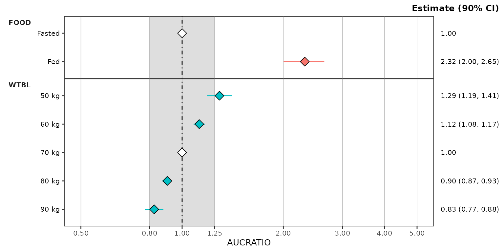

### coveffectsplot styling

[`style_forest_coveffectsplot()`](https://ryancrass.github.io/pmxhelpr/reference/style_forest_coveffectsplot.md)
reproduces the default look of the `forest_plot()` function of the
[coveffectsplot](https://github.com/smouksassi/coveffectsplot/) package:
blue points on thick blue intervals, a dashed reference line, grey
gridlines on both axes, and grey-filled covariate strips.

``` r

plot_forest(forest_obj, metric = "AUCRATIO", ref_band = c(0.8, 1.25),
            style = style_forest_coveffectsplot()) + 
  scale_x_log10(limits = c(0.5, 5), breaks = c(0.5, 0.8, 1, 1.25, 2, 3, 4, 5))
```

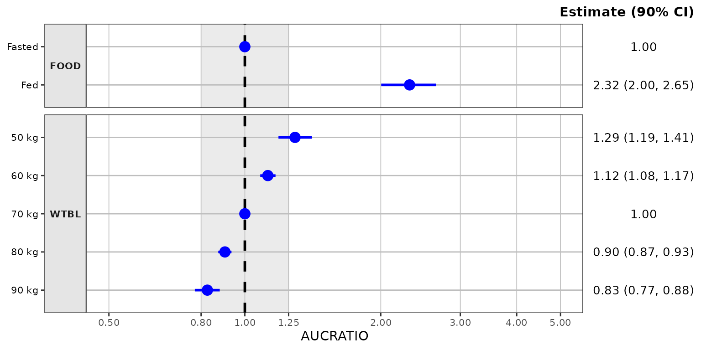

### PMXForest styling

[`style_forest_pmxforest()`](https://ryancrass.github.io/pmxhelpr/reference/style_forest_pmxforest.md)
reproduces the default look of the `forestPlot()` function of
Pharmetheus’ [PMXForest](https://github.com/pharmetheus/PMXForest/)
package, the forest plot of the FREM workflow: black points on uncapped
black intervals, a dotted reference line, and the grey
[`theme_grey()`](https://ggplot2.tidyverse.org/reference/ggtheme.html)
panel.

``` r

plot_forest(forest_obj, metric = "AUCRATIO", ref_band = c(0.8, 1.25),
            style = style_forest_pmxforest()) + 
  scale_x_log10(limits = c(0.5, 5), breaks = c(0.5, 0.8, 1, 1.25, 2, 3, 4, 5))
```

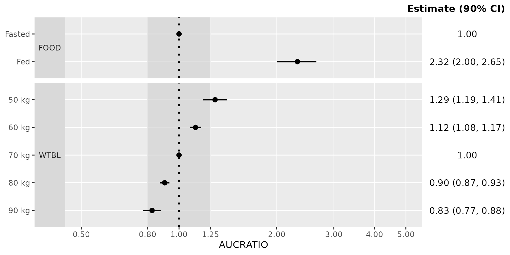

### Pumas styling

[`style_forest_pumas()`](https://ryancrass.github.io/pmxhelpr/reference/style_forest_pumas.md)
reproduces the look of the `table_forest_plot()` function of
[Pumas](https://tutorials.pumas.ai/html/forest_plots/forest.html):
diamonds and capped error bars colored per covariate, a dashed reference
line, and an open panel without gridlines.

``` r

plot_forest(forest_obj, metric = "AUCRATIO", ref_band = c(0.8, 1.25),
            style = style_forest_pumas()) + 
  scale_x_log10(limits = c(0.5, 5), breaks = c(0.5, 0.8, 1, 1.25, 2, 3, 4, 5))
```

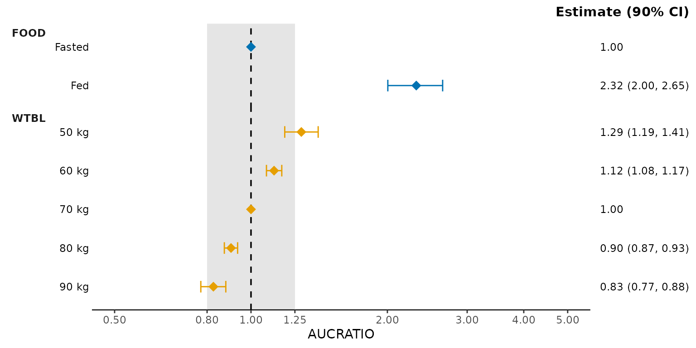

For a deeper treatment of the styling system — `style_spec()` fields,
per-role maps, and post-hoc
[`reveal()`](https://rdrr.io/pkg/ggstylekit/man/reveal.html) — see the
[Plot Styling and
Aesthetics](https://ryancrass.github.io/pmxhelpr/articles/plot-styling.md)
vignette.

## See also

- [Dose-Proportionality
  Workflow](https://ryancrass.github.io/pmxhelpr/articles/doseprop-workflow.md)
  — the sibling dual-mode pipeline
  ([`df_doseprop()`](https://ryancrass.github.io/pmxhelpr/reference/df_doseprop.md)
  /
  [`plot_doseprop()`](https://ryancrass.github.io/pmxhelpr/reference/plot_doseprop.md))
  for power law regression of exposure versus dose.
- [Visual Predictive Check
  Workflow](https://ryancrass.github.io/pmxhelpr/articles/vpc-workflow.md)
  — simulation-based model evaluation with
  [`df_vpcstats()`](https://ryancrass.github.io/pmxhelpr/reference/df_vpcstats.md)
  and
  [`plot_vpc_cont()`](https://ryancrass.github.io/pmxhelpr/reference/plot_vpc_cont.md).
- [Plot Styling and
  Aesthetics](https://ryancrass.github.io/pmxhelpr/articles/plot-styling.md)
  — the `style_*()` presets, `style_spec()` fields and per-role maps,
  and post-hoc
  [`reveal()`](https://rdrr.io/pkg/ggstylekit/man/reveal.html) for
  customizing plot output.
