# Getting Started with pmxhelpr

This vignette is a lean tour of every core `pmxhelpr` workflow in a
single sitting. Each section ends with a link to the corresponding
deep-dive article on the [pmxhelpr
website](https://ryancrass.github.io/pmxhelpr/).

Exported functions follow a `ReturnType_Purpose` naming convention:

- `plot_*` — returns a `ggplot` object
- `df_*` — returns a `data.frame`, or a `pmx_stats` container (`$stats`,
  `$obs`, `$config`) for the stats functions
- `var_*` — returns a vector (vectorized helpers for use inside
  [`mutate()`](https://dplyr.tidyverse.org/reference/mutate.html))
- `style_*` — returns a
  [`ggstylekit::style_spec()`](https://rdrr.io/pkg/ggstylekit/man/style_spec.html)
  style object

The bundled datasets `data_sad` and `data_sad_pkfit` use `ODV` (original
DV). Examples below pass `dv_var = "ODV"` or `dv_var = ODV` to highlight
the non-standard evaluation (NSE) of dataset column name variables which
may be specified as strings or bare names to override defaults in
`pmxhelpr` functions.

``` r

options(scipen = 999, rmarkdown.html_vignette.check_title = FALSE)
library(pmxhelpr)
library(dplyr, warn.conflicts = FALSE)
library(forcats, warn.conflicts = FALSE)
library(ggplot2, warn.conflicts = FALSE)
library(patchwork, warn.conflicts = FALSE)
library(mrgsolve, warn.conflicts = FALSE)
```

## Data

### `data_sad`

`data_sad` is a NLME modeling analysis-ready dataset for single
ascending dose (SAD) study with a parallel food-effect (FE) cohort. It
contains one oral dose input (`EVID=1`, `CMT=1`) and two observation
types (`EVID=0`):

- Drug concentration in `CMT=2` (original units: ng/mL)
- Response in `CMT=3` (original units: percentage of baseline)

``` r

glimpse(data_sad)
#> Rows: 1,404
#> Columns: 25
#> $ ID      <dbl> 1, 1, 1, 1, 1, 1, 1, 1, 1, 1, 1, 1, 1, 1, 1, 1, 1, 1, 1, 1, 1,…
#> $ TIME    <dbl> 0.00, 0.00, 0.00, 0.48, 0.48, 0.81, 0.81, 1.49, 1.49, 2.11, 2.…
#> $ NTIME   <dbl> 0.0, 0.0, 0.0, 0.5, 0.5, 1.0, 1.0, 1.5, 1.5, 2.0, 2.0, 3.0, 3.…
#> $ NDAY    <dbl> 1, 1, 1, 1, 1, 1, 1, 1, 1, 1, 1, 1, 1, 1, 1, 1, 1, 1, 1, 1, 1,…
#> $ DOSE    <dbl> 10, 10, 10, 10, 10, 10, 10, 10, 10, 10, 10, 10, 10, 10, 10, 10…
#> $ AMT     <dbl> 10, NA, NA, NA, NA, NA, NA, NA, NA, NA, NA, NA, NA, NA, NA, NA…
#> $ EVID    <dbl> 1, 0, 0, 0, 0, 0, 0, 0, 0, 0, 0, 0, 0, 0, 0, 0, 0, 0, 0, 0, 0,…
#> $ ODV     <dbl> NA, NA, 100.00000, NA, 99.87700, 1.96000, 99.44932, 3.86000, 9…
#> $ LDV     <dbl> NA, NA, 100.00000, NA, 99.87700, 0.67290, 99.44932, 1.35070, 9…
#> $ CFB     <dbl> NA, NA, 0.0000000, NA, -0.1229974, NA, -0.5506789, NA, -2.3928…
#> $ CONC    <dbl> NA, NA, 0.00, NA, 0.00, NA, 1.96, NA, 3.86, NA, 3.34, NA, 6.83…
#> $ LINE    <dbl> 2, 1, 1, 3, 3, 4, 4, 5, 5, 6, 6, 7, 7, 8, 8, 9, 9, 10, 10, 11,…
#> $ CMT     <dbl> 1, 2, 3, 2, 3, 2, 3, 2, 3, 2, 3, 2, 3, 2, 3, 2, 3, 2, 3, 2, 3,…
#> $ MDV     <dbl> NA, 1, 1, 1, 1, 0, 0, 0, 0, 0, 0, 0, 0, 0, 0, 0, 0, 0, 0, 0, 0…
#> $ BLQ     <dbl> NA, -1, -1, 1, 1, 0, 0, 0, 0, 0, 0, 0, 0, 0, 0, 0, 0, 0, 0, 0,…
#> $ LLOQ    <dbl> NA, 1, 1, 1, 1, 1, 1, 1, 1, 1, 1, 1, 1, 1, 1, 1, 1, 1, 1, 1, 1…
#> $ FOOD    <dbl> 0, 0, 0, 0, 0, 0, 0, 0, 0, 0, 0, 0, 0, 0, 0, 0, 0, 0, 0, 0, 0,…
#> $ SEXF    <dbl> 1, 1, 1, 1, 1, 1, 1, 1, 1, 1, 1, 1, 1, 1, 1, 1, 1, 1, 1, 1, 1,…
#> $ RACE    <dbl> 2, 2, 2, 2, 2, 2, 2, 2, 2, 2, 2, 2, 2, 2, 2, 2, 2, 2, 2, 2, 2,…
#> $ AGEBL   <int> 25, 25, 25, 25, 25, 25, 25, 25, 25, 25, 25, 25, 25, 25, 25, 25…
#> $ WTBL    <dbl> 82.1, 82.1, 82.1, 82.1, 82.1, 82.1, 82.1, 82.1, 82.1, 82.1, 82…
#> $ SCRBL   <dbl> 0.87, 0.87, 0.87, 0.87, 0.87, 0.87, 0.87, 0.87, 0.87, 0.87, 0.…
#> $ CRCLBL  <dbl> 128, 128, 128, 128, 128, 128, 128, 128, 128, 128, 128, 128, 12…
#> $ USUBJID <chr> "STUDYNUM-SITENUM-1", "STUDYNUM-SITENUM-1", "STUDYNUM-SITENUM-…
#> $ PART    <chr> "Part 1-SAD", "Part 1-SAD", "Part 1-SAD", "Part 1-SAD", "Part …
```

The pre-processing step below creates a new variable combining dose,
frequency, and food status into a single dosing regimen variable with
per-group subject counts appended using
[`var_addn()`](https://ryancrass.github.io/pmxhelpr/reference/var_addn.md).
Separate datasets are also defined for exploration of PK and PD data.

``` r

data <- data_sad %>%
  mutate(Food = ifelse(FOOD == 1, "Fed", "Fasted"),
         DoseFood = paste(DOSE, "mg x1", Food),
         Regimen = var_addn(DoseFood, ID))

data_pk <- data %>% filter(CMT %in% c(1,2))
data_pd <- data %>% filter(CMT %in% c(1,3))

unique(data$Regimen)
#> [1] 10 mg x1 Fasted (n=6)  50 mg x1 Fasted (n=6)  100 mg x1 Fasted (n=6)
#> [4] 100 mg x1 Fed (n=6)    200 mg x1 Fasted (n=6) 400 mg x1 Fasted (n=6)
#> 6 Levels: 10 mg x1 Fasted (n=6) ... 400 mg x1 Fasted (n=6)
```

### `data_sad_nca`

`data_sad_nca` contains PK parameters and exposure metrics from a
non-compartmental analysis (NCA) of `data_sad` using the `PKNCA`
package.

We will filter to Part 1 fasted conditions only for use in
dose-proportionality assessment.

``` r

glimpse(data_sad_nca)
#> Rows: 648
#> Columns: 11
#> $ ID         <dbl> 1, 1, 1, 1, 1, 1, 1, 1, 1, 1, 1, 1, 1, 1, 1, 1, 1, 1, 2, 2,…
#> $ DOSE       <dbl> 10, 10, 10, 10, 10, 10, 10, 10, 10, 10, 10, 10, 10, 10, 10,…
#> $ PART       <chr> "Part 1-SAD", "Part 1-SAD", "Part 1-SAD", "Part 1-SAD", "Pa…
#> $ start      <dbl> 0, 0, 0, 0, 0, 0, 0, 0, 0, 0, 0, 0, 0, 0, 0, 0, 0, 0, 0, 0,…
#> $ end        <dbl> Inf, Inf, Inf, Inf, Inf, Inf, Inf, Inf, Inf, Inf, Inf, Inf,…
#> $ PPTESTCD   <chr> "auclast", "cmax", "tmax", "tlast", "clast.obs", "lambda.z"…
#> $ PPORRES    <dbl> 278.48468681530, 13.08000000000, 7.81000000000, 35.95000000…
#> $ exclude    <chr> NA, NA, NA, NA, NA, NA, NA, NA, NA, NA, NA, NA, NA, NA, NA,…
#> $ units_dose <chr> "mg", "mg", "mg", "mg", "mg", "mg", "mg", "mg", "mg", "mg",…
#> $ units_conc <chr> "ng/mL", "ng/mL", "ng/mL", "ng/mL", "ng/mL", "ng/mL", "ng/m…
#> $ units_time <chr> "hours", "hours", "hours", "hours", "hours", "hours", "hour…
data_nca_part1 <- filter(data_sad_nca, PART == "Part 1-SAD")
```

### `data_sad_pkfit`

`data_sad_pkfit` is a model output dataset version of `data_sad`
(`CMT`=1, 2) with two additional variables (`PRED` and `IPRED`)
appended. These variables are derived from the internal PK model
`pkmodel`.

``` r

pkmodel <- model_mread_load("pkmodel")
see(pkmodel)
#> 
#> Model file:  pkmodel.cpp 
#> $PARAM
#> TVCL = 20
#> TVVC = 35.7
#> TVKA = 0.3
#> TVQ = 25
#> TVVP = 150
#> DOSE_F1 = 0.33
#> 
#> WT_CL = 0.75
#> WT_VC = 1.00
#> WT_Q = 0.75
#> WT_VP = 1.00
#> FOOD_KA = -0.5
#> FOOD_F1 = 1.33
#> 
#> WT = 70
#> DOSE = 100
#> FOOD = 0
#> 
#> $CMT GUT CENT PERIPH TRANS1 TRANS2
#> 
#> $MAIN
#> double CL = TVCL*pow(WT/70,WT_CL)*exp(ETA_CL);
#> double VC  = TVVC*pow(WT/70, WT_VC)*exp(ETA_VC);
#> double Q = TVQ*pow(WT/70,WT_Q)*exp(ETA_Q);
#> double VP  = TVVP*pow(WT/70, WT_VP)*exp(ETA_VP);
#> double KA = TVKA*(1+FOOD_KA*FOOD)*exp(ETA_KA);
#> double F1 = 1*(1+FOOD_F1*FOOD)*pow(DOSE/100,DOSE_F1);
#> 
#> F_GUT = F1;
#> 
#> $ODE
#> dxdt_GUT = -KA*GUT;
#> dxdt_CENT = KA*TRANS1 - (CL/VC)*CENT + (Q/VP)*PERIPH - (Q/VC)*CENT;
#> dxdt_PERIPH = (Q/VC)*CENT - (Q/VP)*PERIPH;
#> dxdt_TRANS1 = KA*GUT - KA*TRANS1;
#> dxdt_TRANS2 = KA*TRANS1 - KA*TRANS2;
#> 
#> $OMEGA @labels ETA_CL ETA_VC ETA_KA ETA_Q ETA_VP
#> 0.075 0.1 0.2 0 0
#> 
#> $SIGMA @labels PROP
#> 0.09
#> 
#> $TABLE
#> capture IPRED = CENT/(VC/1000);
#> capture DV = IPRED*(1+PROP);
#> capture Y = DV;
```

We will process this dataset in a manner analogous to `data_sad`.

``` r

data_gof <- data_sad_pkfit %>%
  mutate(Food = ifelse(FOOD == 1, "Fed", "Fasted"),
         DoseFood = paste(DOSE, "mg x1", Food),
         Regimen = var_addn(DoseFood, ID)) 
```

### `data_sad_pkforest`

`data_sad_pkforest` is a per replicate simulation dataset of PK exposure
metrics (absolute and test/reference ratios) across six covariate
scenarios (reference, fed, and 50, 60, 80, 90 kg body weight), built
from the raw replicate output in `data_sad_pkforest_sim`. The reference
scenario is fasted at 70 kg; that mapping is passed to
[`df_forest()`](https://ryancrass.github.io/pmxhelpr/reference/df_forest.md)
as `cov_level_ref` below.

``` r

glimpse(data_sad_pkforest)
#> Rows: 24,000
#> Columns: 9
#> $ ID        <dbl> 1, 1, 1, 1, 1, 1, 1, 1, 1, 1, 1, 1, 1, 1, 1, 1, 1, 1, 1, 1, …
#> $ SIM       <dbl> 1, 1, 1, 1, 1, 1, 1, 1, 2, 2, 2, 2, 2, 2, 2, 2, 3, 3, 3, 3, …
#> $ WTBL      <dbl> 70, 70, 70, 70, 70, 70, 70, 70, 70, 70, 70, 70, 70, 70, 70, …
#> $ FOOD      <dbl> 0, 0, 0, 0, 0, 0, 0, 0, 0, 0, 0, 0, 0, 0, 0, 0, 0, 0, 0, 0, …
#> $ DOSE      <dbl> 200, 200, 200, 200, 200, 200, 200, 200, 200, 200, 200, 200, …
#> $ metric    <chr> "CMAX", "CMIN", "AUC", "CAVG", "CMAXRATIO", "CMINRATIO", "AU…
#> $ value     <dbl> 844.8669, 200.0502, 12006.2897, 500.2621, 1.0000, 1.0000, 1.…
#> $ cov_name  <chr> "Reference", "Reference", "Reference", "Reference", "Referen…
#> $ cov_level <chr> "Reference", "Reference", "Reference", "Reference", "Referen…
```

## Longitudinal concentration and response with `plot_dvtime()`

[`plot_dvtime()`](https://ryancrass.github.io/pmxhelpr/reference/plot_dvtime.md)
produces a longitudinal plot of a repeated measures, continuous variable
versus time. This plotting function can be used for longitudinal
exploratory analysis of both concentration (`CMT = 2`) and response
(`CMT = 3`) over time, with functionality for central tendency,
variability, and BLQ handling.

``` r

pk_plot <- plot_dvtime(
  data = data_pk,
  dv_var = ODV,
  cent = "mean_sdl",
  col_var = Regimen,
  log_y = TRUE,
  show_obs = FALSE
) +
  labs(y = "Concentration (ng/mL)", x = "Time (hours)")
pk_plot
```

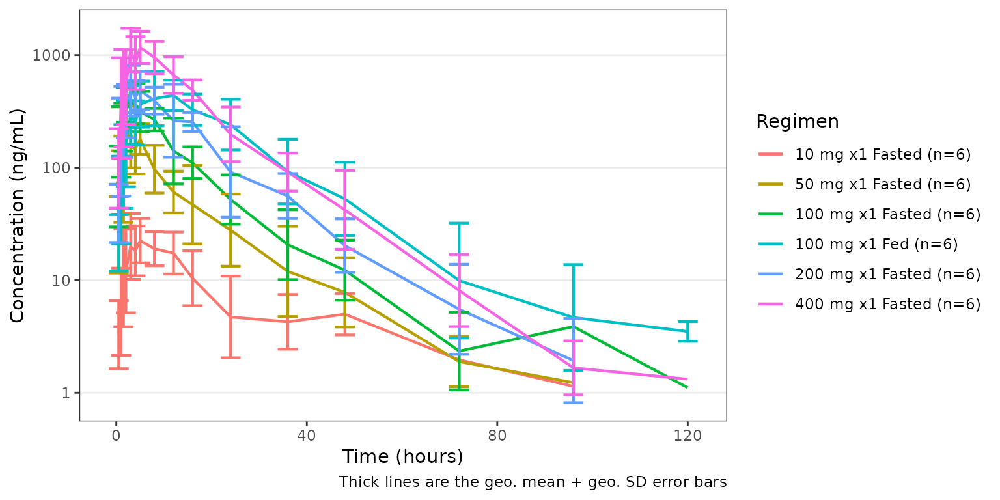

``` r

pd_plot <- plot_dvtime(
  data = data_pd,
  dv_var = "CFB",
  cent = "mean_sdl",
  col_var = Regimen,
  show_obs = FALSE
) +
  labs(y = "Response (% Change from Baseline)", x = "Time (hours)")
pd_plot
```

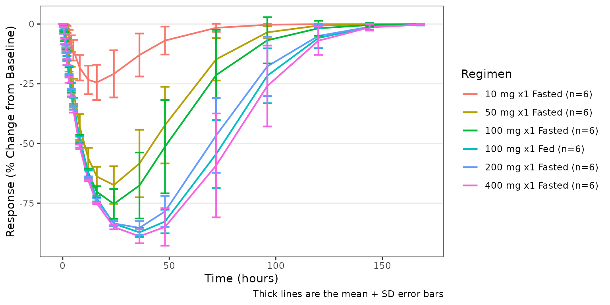 The two
plots can be composed into a single paneled figure using the `patchwork`
package, aligned vertically with the shared time axis.

``` r

(pk_plot / pd_plot) + plot_layout(guides = "collect")
```

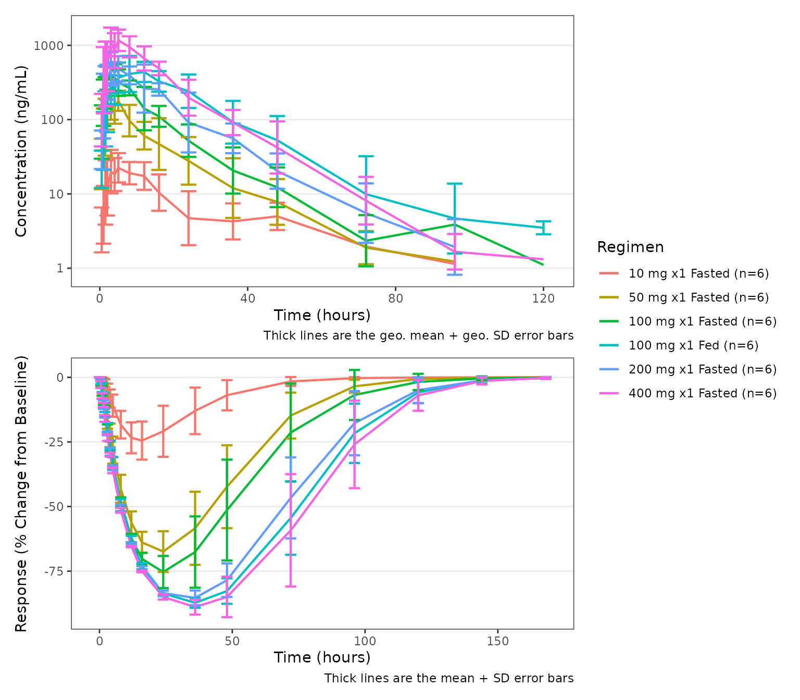

See the [Exploratory Analyses of PK and PK/PD
Data](https://ryancrass.github.io/pmxhelpr/articles/eda-pk-pkpd-workflow.md)
article for additional details on exploratory data analyses with
`pmxhelpr`.

## Response versus concentration with `plot_dvconc()`

[`plot_dvconc()`](https://ryancrass.github.io/pmxhelpr/reference/plot_dvconc.md)
plots a continuous dependent variable versus a continuous independent
variable. The most common use case is visualizing a pharmacodynamic
response versus drug concentration. Trend line options include both
linear (`linear`/`se_linear`) and non-linear (`loess`/`se_loess`)
logical toggles.

A dashed black reference line is drawn at `y = ref` when `ref` is
specified.

``` r

plot_dvconc(
  data = filter(data, CMT == 3),
  dv_var = CFB,
  idv_var = CONC,
  ref = 0,
  col_var = Regimen,
  loess = TRUE,
  linear = TRUE
) +
  labs(y = "Response (% Change from Baseline)", x = "Concentration (ng/mL)")
```

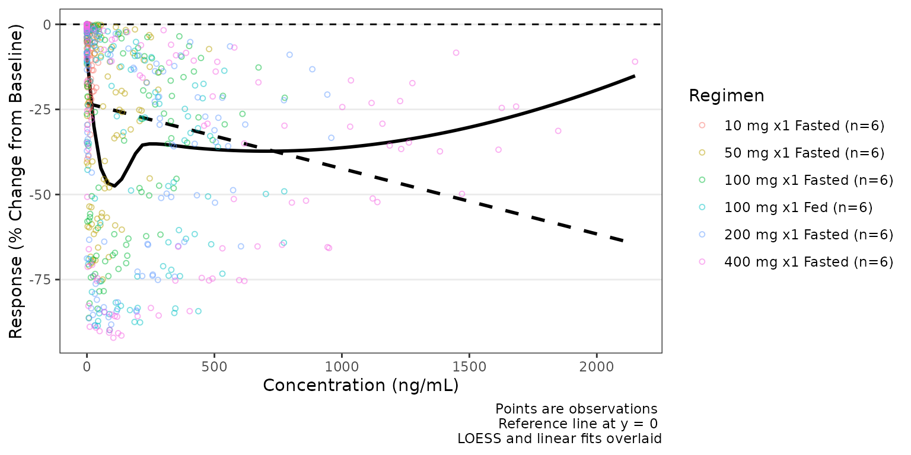

By default the trend lines are not grouped by the variable passed to
`col_var`; however, this can be toggled on with `col_trend=TRUE`.

``` r

plot_dvconc(
  data = filter(data, CMT == 3),
  dv_var = CFB,
  idv_var = CONC,
  ref = 0,
  col_var = Regimen,
  loess = TRUE,
  se_loess = TRUE,
  linear = FALSE,
  col_trend = TRUE
) +
  labs(y = "Response (% Change from Baseline)", x = "Concentration (ng/mL)")
```

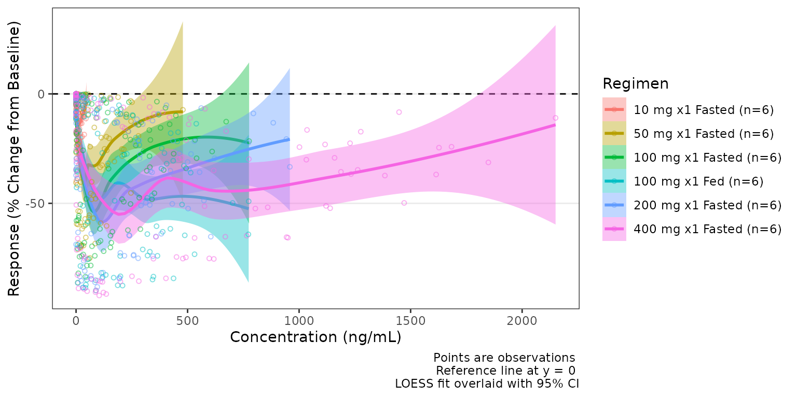

See the [Exploratory Analyses of PK and PK/PD
Data](https://ryancrass.github.io/pmxhelpr/articles/eda-pk-pkpd-workflow.md)
article for additional details on exploratory data analyses with
`pmxhelpr`.

## Dose-proportionality with `df_doseprop()` and `plot_doseprop()`

[`df_doseprop()`](https://ryancrass.github.io/pmxhelpr/reference/df_doseprop.md)
fits a log-log regression of exposure metrics (e.g., Cmax and AUC)
versus dose and returns a `doseprop_stats` container.

``` r

tab <- df_doseprop(data_nca_part1, metrics = c("aucinf.obs", "cmax"))
tab
#> <doseprop_stats>
#>   stats: 2 rows x 10 columns
#>   obs:   60 rows
#>   config: metric_name_var = PPTESTCD, metric_value_var = PPORRES, dose_var = DOSE, ci = 0.9, method = normal
#> 
#>   stats body:
#>   Intercept StandardError  CI Power   LCL  UCL Proportional
#> 1      3.97        0.0437 90% 0.979 0.907 1.05         TRUE
#> 2      1.02        0.0597 90% 1.060 0.959 1.16         TRUE
#>                            PowerCI    Interpretation   PPTESTCD
#> 1 Power: 0.979 (90% CI 0.907-1.05) Dose-proportional aucinf.obs
#> 2  Power: 1.06 (90% CI 0.959-1.16) Dose-proportional       cmax
#> 
#>   Use `x$obs` for the observation overlay.
```

[`plot_doseprop()`](https://ryancrass.github.io/pmxhelpr/reference/plot_doseprop.md)
can directly process an NCA input dataset (1-stage) or accept a
previously processed `doseprop_stats` object (2-stage)

1.  One-stage: raw NCA `data.frame` input
    ([`df_doseprop()`](https://ryancrass.github.io/pmxhelpr/reference/df_doseprop.md)
    called internally)

``` r

plot_doseprop(data_nca_part1, metrics = c("aucinf.obs", "cmax"))
```

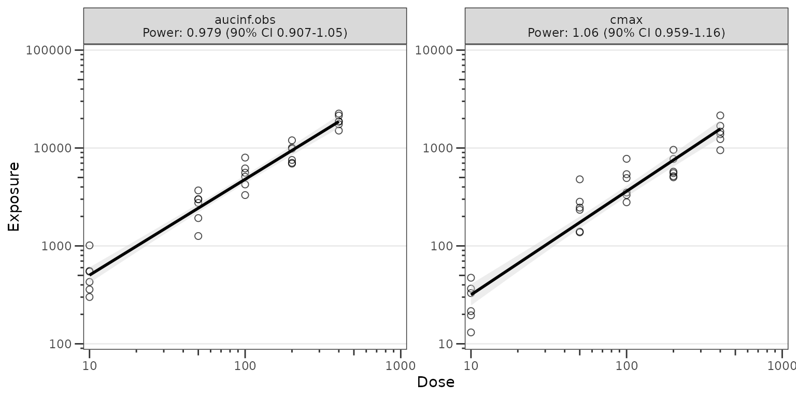

2.  Two-stage: a `doseprop_stats` object (computed separately with
    [`df_doseprop()`](https://ryancrass.github.io/pmxhelpr/reference/df_doseprop.md)

``` r

plot_doseprop(tab)
```


See the [Dose-Proportionality
Workflow](https://ryancrass.github.io/pmxhelpr/articles/doseprop-workflow.md)
article for additional details on dose-proportionality assessment with
`pmxhelpr`.

## Model diagnostics with `plot_gof()`

[`plot_gof()`](https://ryancrass.github.io/pmxhelpr/reference/plot_gof.md)
produces a population overlay goodness-of-fit (GOF) plot depicting
binned central tendency layers of observed values (`dv`), individual
predictions (`ipred`), and population predictions (`pred`) over time
along with the underlying observed data (`obs`) scatter.

In most cases, these plots will be drawn using model output tables
directly from estimation engines (e.g., NONMEM), which will only include
predictions at non-missing timepoints included in parameter estimation
(e.g., MDV=0). The input dataset `data_gof` (derived from
`data_sad_pkfit`) includes model predictions from
[`mrgsolve::mrgsim()`](https://mrgsolve.org/docs/reference/mrgsim.html)
at all timepoints; therefore, we will filter on input to mimic this
common scenario.

``` r

plot_gof(data = filter(data_gof, MDV == 0), dv_var = ODV, log_y = TRUE) +
  facet_wrap(~Regimen) +
  scale_x_continuous(limits = c(0, 168), breaks = c(0, 24, 72, 120, 168))+
  labs(y = "Concentration (ng/mL)", x = "Time (hours)")
```

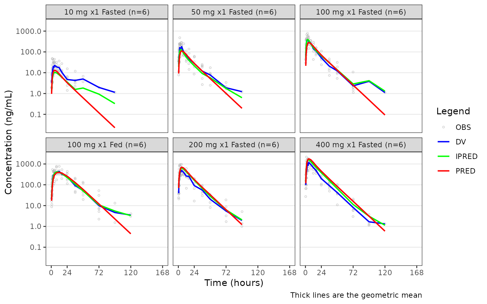

See the [Goodness-of-Fit
Diagnostics](https://ryancrass.github.io/pmxhelpr/articles/gof-diagnostics.md)
article for additional details on GOF diagnostics.

## VPC model evaluation with `plot_vpc_cont()` and `plot_vpc_cens()`

The VPC workflow is an end to end process within `pmxhelpr`, starting
from a fitted model that has been translated to an `mrgsolve` model
format (`mrgmod`).

From a validated model file, the VPC pipeline includes functionality to:

1.  replicate the input dataset with
    [`df_mrgsim_replicate()`](https://ryancrass.github.io/pmxhelpr/reference/df_mrgsim_replicate.md)
2.  derive summary statistics within and across replicates with
    [`df_vpcstats()`](https://ryancrass.github.io/pmxhelpr/reference/df_vpcstats.md)
3.  build plots with
    [`plot_vpc_cont()`](https://ryancrass.github.io/pmxhelpr/reference/plot_vpc_cont.md)
    /
    [`plot_vpc_cens()`](https://ryancrass.github.io/pmxhelpr/reference/plot_vpc_cens.md)

### Run the simulation with `df_mrgsim_replicate()`

[`df_mrgsim_replicate()`](https://ryancrass.github.io/pmxhelpr/reference/df_mrgsim_replicate.md)
is a wrapper function for
[`mrgsolve::mrgsim_df()`](https://mrgsolve.org/docs/reference/mrgsim.html),
which uses [`lapply()`](https://rdrr.io/r/base/lapply.html) to iterate
from 1 to the integer value passed to `replicates`.

There are 3 required arguments to
[`df_mrgsim_replicate()`](https://ryancrass.github.io/pmxhelpr/reference/df_mrgsim_replicate.md):

- `data`, a `data.frame` modeling analysis dataset
- `model`, a `mrgmod` model object
- `replicates`, integer number of replicates to perform.

The are optional arguments specifying key dataset variables to be input
into the simulation or captured in output. These include:

- `dv_var` = DV, dependent variable
- `time_var` = TIME, actual time variable
- `ntime_var` = NTIME, nominal time variable
- `pred_var` = PRED, population prediction variable
- `ipred_var` = IPRED, individual prediction variable
- `sim_dv_var` = DV, dependent variable captured in the simulated output

``` r

simout <- df_mrgsim_replicate(
  data = data_pk,
  model = pkmodel,
  replicates = 100,
  dv_var = "ODV",
  sim_dv_var = DV,
  carry_out = c("DOSE", "FOOD", "BLQ", "LLOQ"),
  recover  = c("PART", "Regimen")
) 
glimpse(simout)
#> Rows: 72,000
#> Columns: 23
#> $ ID      <dbl> 1, 1, 1, 1, 1, 1, 1, 1, 1, 1, 1, 1, 1, 1, 1, 1, 1, 1, 1, 1, 2,…
#> $ TIME    <dbl> 0.00, 0.00, 0.48, 0.81, 1.49, 2.11, 3.05, 4.14, 5.14, 7.81, 12…
#> $ NTIME   <dbl> 0.0, 0.0, 0.5, 1.0, 1.5, 2.0, 3.0, 4.0, 5.0, 8.0, 12.0, 16.0, …
#> $ PRED    <dbl> 0.0000000000, 0.0000000000, 1.0167419653, 2.3937058312, 5.5900…
#> $ IPRED   <dbl> 0.000000000000, 0.000000000000, 0.235847746922, 0.565977888471…
#> $ SIMDV   <dbl> 0.00000000000, 0.00000000000, 0.27481366281, 0.72982921961, 1.…
#> $ OBSDV   <dbl> NA, NA, NA, 1.96, 3.86, 3.34, 6.83, 8.87, 11.92, 13.08, 12.09,…
#> $ EVID    <dbl> 1, 0, 0, 0, 0, 0, 0, 0, 0, 0, 0, 0, 0, 0, 0, 0, 0, 0, 0, 0, 1,…
#> $ CMT     <dbl> 1, 2, 2, 2, 2, 2, 2, 2, 2, 2, 2, 2, 2, 2, 2, 2, 2, 2, 2, 2, 1,…
#> $ MDV     <dbl> NA, 1, 1, 0, 0, 0, 0, 0, 0, 0, 0, 0, 0, 0, 1, 1, 1, 1, 1, 1, N…
#> $ DOSE    <dbl> 10, 10, 10, 10, 10, 10, 10, 10, 10, 10, 10, 10, 10, 10, 10, 10…
#> $ FOOD    <dbl> 0, 0, 0, 0, 0, 0, 0, 0, 0, 0, 0, 0, 0, 0, 0, 0, 0, 0, 0, 0, 0,…
#> $ BLQ     <dbl> NA, -1, 1, 0, 0, 0, 0, 0, 0, 0, 0, 0, 0, 0, 1, 1, 1, 1, 1, 1, …
#> $ LLOQ    <dbl> NA, 1, 1, 1, 1, 1, 1, 1, 1, 1, 1, 1, 1, 1, 1, 1, 1, 1, 1, 1, N…
#> $ GUT     <dbl> 4.67735141287198175, 4.67735141287198175, 4.34652773934869341,…
#> $ CENT    <dbl> 0.0000000000000, 0.0000000000000, 0.0096205556135, 0.023087020…
#> $ PERIPH  <dbl> 0.000000000000, 0.000000000000, 0.000987768543, 0.004109113878…
#> $ TRANS1  <dbl> 0.0000000000000000, 0.0000000000000000, 0.3188382669140359, 0.…
#> $ TRANS2  <dbl> 0.00000000000000, 0.00000000000000, 0.01169414511677, 0.031663…
#> $ Y       <dbl> 0.00000000000, 0.00000000000, 0.27481366281, 0.72982921961, 1.…
#> $ PART    <chr> "Part 1-SAD", "Part 1-SAD", "Part 1-SAD", "Part 1-SAD", "Part …
#> $ Regimen <fct> 10 mg x1 Fasted (n=6), 10 mg x1 Fasted (n=6), 10 mg x1 Fasted …
#> $ SIM     <int> 1, 1, 1, 1, 1, 1, 1, 1, 1, 1, 1, 1, 1, 1, 1, 1, 1, 1, 1, 1, 1,…
```

### Calculate summary statistics with `df_vpcstats()`

`df_vpcstats` performs the input data validation and summary statistic
calculations for the VPC, returning a `vpc_stats` S3 container
including:

- `$stats` (`data.frame` of summary statistics)
- `$obs` observed data for scatter plot overlay
- `$config` configuration info (e.g., replicates, loq, stratifying
  variable).

`vpc_stats` objects contain both standard, prediction-correction, and
proportion BLQ statistics and may be passed directly to
[`plot_vpc_cont()`](https://ryancrass.github.io/pmxhelpr/reference/plot_vpc_cont.md)
or
[`plot_vpc_cens()`](https://ryancrass.github.io/pmxhelpr/reference/plot_vpc_cens.md)
following a 2-stage workflow. Both plotting functions can also take in
the raw simulated output and call
[`df_vpcstats()`](https://ryancrass.github.io/pmxhelpr/reference/df_vpcstats.md)
internally in a one-stage workflow.

``` r

vpcstats_obj_part <- df_vpcstats(simout, strat_var = PART)
#> Inheriting per-row `loq` from `LLOQ` column in `data`.
vpcstats_obj_regimen <- df_vpcstats(simout, strat_var = Regimen)
#> Inheriting per-row `loq` from `LLOQ` column in `data`.

vpcstats_obj_part
#> <vpc_stats>
#>   stats: 38 rows x 35 columns
#>   obs:   506 rows
#>   config: n_replicates = 100, loq = 1, strat_var = PART
#>   column groups (stats):
#>     identifiers  : BIN_MID, PART
#>     counts       : obs_n, obs_n_blq, obs_prop_blq
#>     sim BLQ      : sim_prop_blq_low, sim_prop_blq_med, sim_prop_blq_hi  [std-only]
#>     std observed : obs_low, obs_med, obs_hi
#>     std simulated: sim_low_low, sim_low_med, sim_low_hi, sim_med_low, sim_med_med, sim_med_hi, sim_hi_low, sim_hi_med, sim_hi_hi
#>     pc observed  : pc_obs_low, pc_obs_med, pc_obs_hi
#>     pc simulated : pc_sim_low_low, pc_sim_low_med, pc_sim_low_hi, pc_sim_med_low, pc_sim_med_med, pc_sim_med_hi, pc_sim_hi_low, pc_sim_hi_med, pc_sim_hi_hi
#>     metadata     : ci, pi_low, pi_hi
#> 
#>   head(stats, 3):
#> # A tibble: 3 × 35
#>   BIN_MID PART    obs_n obs_n_blq obs_prop_blq sim_prop_blq_low sim_prop_blq_med
#>     <dbl> <chr>   <int>     <int>        <dbl>            <dbl>            <dbl>
#> 1     0   Part 1…    30        30       1                1                 1    
#> 2     0   Part 2…     6         6       1                1                 1    
#> 3     0.5 Part 1…    30         2       0.0667           0.0667            0.133
#> # ℹ 28 more variables: sim_prop_blq_hi <dbl>, obs_low <dbl>, obs_med <dbl>,
#> #   obs_hi <dbl>, sim_low_low <dbl>, sim_low_med <dbl>, sim_low_hi <dbl>,
#> #   sim_med_low <dbl>, sim_med_med <dbl>, sim_med_hi <dbl>, sim_hi_low <dbl>,
#> #   sim_hi_med <dbl>, sim_hi_hi <dbl>, pc_obs_low <dbl>, pc_obs_med <dbl>,
#> #   pc_obs_hi <dbl>, pc_sim_low_low <dbl>, pc_sim_low_med <dbl>,
#> #   pc_sim_low_hi <dbl>, pc_sim_med_low <dbl>, pc_sim_med_med <dbl>,
#> #   pc_sim_med_hi <dbl>, pc_sim_hi_low <dbl>, pc_sim_hi_med <dbl>, …
#> 
#>   Use `x$stats` and `x$obs` for the underlying data.frames.
```

### Plotting the continuous data range with `plot_vpc_cont`

[`plot_vpc_cont()`](https://ryancrass.github.io/pmxhelpr/reference/plot_vpc_cont.md)
builds standard or prediction-corrected VPCs of the continuous,
quantifiable range above the LLOQ.

The example below is a standard (non-prediction-corrected) VPC
stratified by `Regimen`.

``` r

vpc_regimen <- plot_vpc_cont(
  data = simout,
  strat_var = Regimen
) +
  scale_x_continuous(breaks = seq(0, 168, 24)) +
  scale_y_log10(guide = "axis_logticks") +
  labs(x = "Time (hours)", y = "Concentration (ng/mL)")
vpc_regimen
```

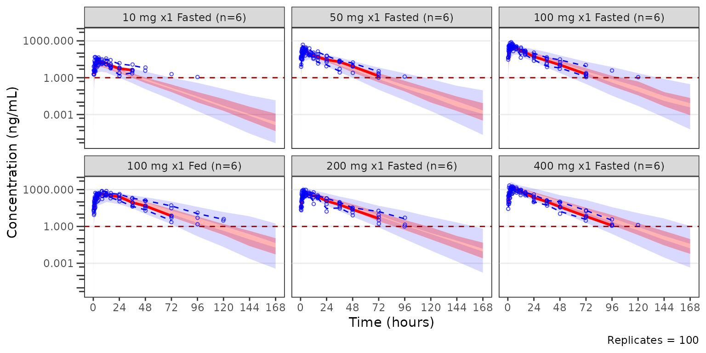

The example below is a pcVPC stratified by PART.

``` r

pcvpc_part <- plot_vpc_cont(
  data = simout,
  strat_var = PART,
  pcvpc = TRUE
) +
  scale_x_continuous(breaks = seq(0, 168, 24)) +
  scale_y_log10(guide = "axis_logticks") +
  labs(x = "Time (hours)", y = "Pred-corrected Conc. (ng/mL)")
pcvpc_part
```

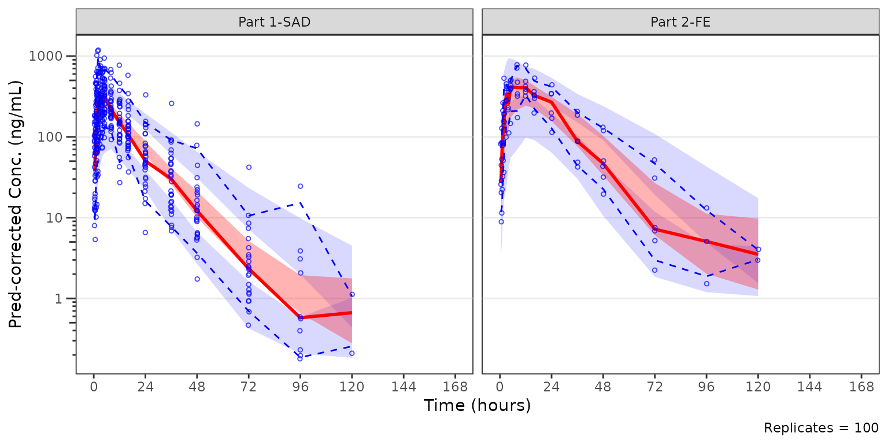 \##
Plotting the censored data range with `plot_vpc_cens`

[`plot_vpc_cens()`](https://ryancrass.github.io/pmxhelpr/reference/plot_vpc_cens.md)
is the companion diagnostic for the censored portion of the data range.
It mirrors
[`plot_vpc_cont()`](https://ryancrass.github.io/pmxhelpr/reference/plot_vpc_cont.md)
but plots `obs_prop_blq` and the non-parametric confidence band of
`sim_prop_blq` across replicates. VPC plots of the censored data range
should be generated prior to prediction-corrected VPCs (pcVPCs) to
ensure that the model is adequately predictive of the censored data
range prior to generating pcVPCs of the quantifiable data range.

The most relevant censored VPC is that stratified by dose and food
status, which are combined in the `Regimen` variable.

``` r

cens_vpc_regimen <- plot_vpc_cens(
  data = simout,
  strat_var = Regimen,
  loq = 1
) +
  scale_x_continuous(breaks = seq(0, 168, 24)) +
  labs(x = "Time (hours)", y = "Proportion BLQ")
cens_vpc_regimen
```

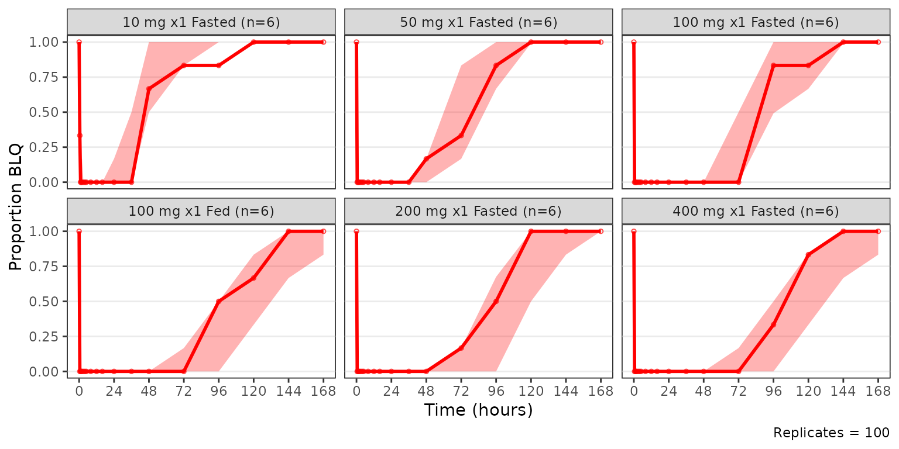

### Adding panels and legends with `patchwork` and `plot_vpc_legend()`

[`plot_vpc_legend()`](https://ryancrass.github.io/pmxhelpr/reference/plot_vpc_legend.md)
returns a legend that can be combined with the VPC plots using the
`patchwork` package. The four row layout below stacks the continuous and
censored VPCs with their corresponding legends.

The two-stage plot building from a`vpc_stats` objects is also
demonstrated, highlighting the potential efficiencies of reusing a
pre-computed object.

``` r

vpc_plot_cont <- plot_vpc_cont(vpcstats_obj_regimen) + 
  scale_x_continuous(breaks = seq(0, 168, 24)) +
  scale_y_log10(guide = "axis_logticks") +
  labs(x = "Time (hours)", y = "Concentration (ng/mL)")

vpc_plot_cens <- plot_vpc_cens(vpcstats_obj_regimen) +
  scale_x_continuous(breaks = seq(0, 168, 24)) +
  labs(x = "Time (hours)", y = "Proportion BLQ")

cont_legend <- plot_vpc_legend()
cens_legend <- plot_vpc_legend(type = "cens", shown = plot_vpc_shown(obs_point = FALSE))

vpc_plot_cont / cont_legend / vpc_plot_cens / cens_legend + 
  plot_layout(heights = c(2, 0.5, 1, 0.5))
```

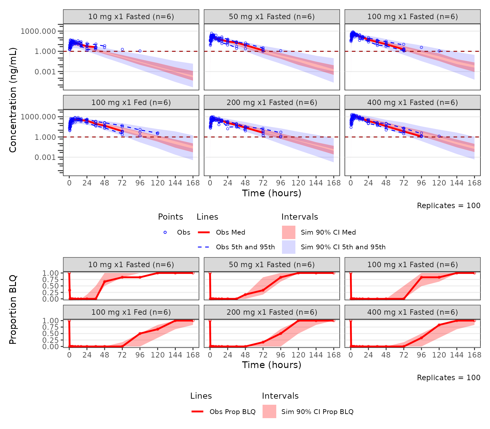

See the [Visual Predictive Check
Workflow](https://ryancrass.github.io/pmxhelpr/articles/vpc-workflow.md)
article for additional details on the VPC toolchain with `pmxhelpr`.

## Forest plots of covariate impact with `df_forest()` and `plot_forest()`

[`df_forest_preprocess()`](https://ryancrass.github.io/pmxhelpr/reference/df_forest_preprocess.md)
is an upstream pre-processing function which reshapes raw replicate
simulation output containing one row per scenario per replicate with the
exposure metrics as columns, into the long form consumed by
[`df_forest()`](https://ryancrass.github.io/pmxhelpr/reference/df_forest.md).
Within-replicate test-to-reference ratios are computed along the way.
That is how `data_sad_pkforest` is built from `data_sad_pkforest_sim`.
See the [Forest Plot
Workflow](https://ryancrass.github.io/pmxhelpr/articles/forest-workflow.md)
article for more information.

``` r

forest_preprocess <- df_forest_preprocess(
  data_sad_pkforest_sim,
  metric_vars   = c("CMAX", "CMIN", "AUC", "CAVG"),
  cov_vars      = c("FOOD", "WTBL"),
  cov_val_ref = c(FOOD = 0, WTBL = 70),
  cov_labels    = list(
    FOOD = c("0" = "Fasted", "1" = "Fed"),
    WTBL = function(x) paste(x, "kg")
  )
)
glimpse(forest_preprocess)
#> Rows: 24,000
#> Columns: 9
#> $ ID        <dbl> 1, 1, 1, 1, 1, 1, 1, 1, 1, 1, 1, 1, 1, 1, 1, 1, 1, 1, 1, 1, …
#> $ SIM       <dbl> 1, 1, 1, 1, 1, 1, 1, 1, 2, 2, 2, 2, 2, 2, 2, 2, 3, 3, 3, 3, …
#> $ WTBL      <dbl> 70, 70, 70, 70, 70, 70, 70, 70, 70, 70, 70, 70, 70, 70, 70, …
#> $ FOOD      <dbl> 0, 0, 0, 0, 0, 0, 0, 0, 0, 0, 0, 0, 0, 0, 0, 0, 0, 0, 0, 0, …
#> $ DOSE      <dbl> 200, 200, 200, 200, 200, 200, 200, 200, 200, 200, 200, 200, …
#> $ metric    <chr> "CMAX", "CMIN", "AUC", "CAVG", "CMAXRATIO", "CMINRATIO", "AU…
#> $ value     <dbl> 844.8669, 200.0502, 12006.2897, 500.2621, 1.0000, 1.0000, 1.…
#> $ cov_name  <chr> "Reference", "Reference", "Reference", "Reference", "Referen…
#> $ cov_level <chr> "Reference", "Reference", "Reference", "Reference", "Referen…
```

[`df_forest()`](https://ryancrass.github.io/pmxhelpr/reference/df_forest.md)
turns the draws into a median and 90% CI per covariate level.
`cov_level_ref` also draws the reference row inside each covariate panel
(`Fasted`, `70 kg`). Rows plot in the order of `$stats`; reorder it, or
set factor levels on `cov_level`, to change it.

``` r

forest_obj <- df_forest(data_sad_pkforest,
                        cov_level_ref = c(FOOD = "Fasted", WTBL = "70 kg"))
forest_obj
#> <forest_stats>
#>   stats: 64 rows x 13 columns
#>   config: metric_name_var = metric, metric_value_var = value, cov_name_var = cov_name, cov_level_var = cov_level, ci = 0.9, sigdigits = 3, cov_name_ref = Reference, cov_level_ref = c(FOOD = "Fasted", WTBL = "70 kg")
#> 
#>   head(stats, 3):
#>   metric  cov_name cov_level       est       lo       hi   n est_label lo_label
#> 1   CMAX Reference Reference  861.3751  741.241 1005.205 500       861      741
#> 2   CMAX      FOOD    Fasted  861.3751  741.241 1005.205 500       861      741
#> 3   CMAX      FOOD       Fed 1465.1054 1180.176 1830.221 500      1465     1180
#>   hi_label          ci_label is_ref       layout
#> 1     1005   861 (741, 1005)   TRUE consolidated
#> 2     1005   861 (741, 1005)   TRUE  distributed
#> 3     1830 1465 (1180, 1830)  FALSE         both
#> 
#>   Use `x$stats` for the full data.frame.
```

[`plot_forest()`](https://ryancrass.github.io/pmxhelpr/reference/plot_forest.md)
is dual-mode plotting function which can accept the raw pre-processed
long-form simulation data (one-stage, calling
[`df_forest()`](https://ryancrass.github.io/pmxhelpr/reference/df_forest.md)
internally) or a precomputed `forest_stats` object (two-stage).

The two-stage workflow below renders one metric at a time and composes
with `ggplot2` for axis customization.

``` r

plot_forest(forest_obj, metric = "AUCRATIO", ref_band = c(0.8, 1.25)) +
  scale_x_log10(limits = c(0.5, 5), breaks = c(0.5, 0.8, 1, 1.25, 2, 3, 4, 5))
```

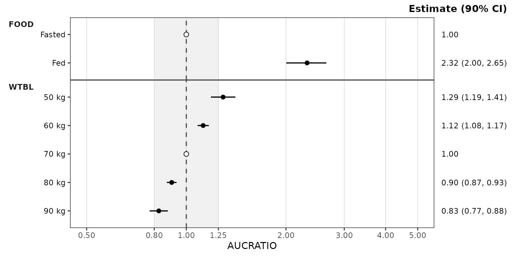

Per-covariate panel colors are opt-in through the `colors` map of
[`style_forest()`](https://ryancrass.github.io/pmxhelpr/reference/style_forest.md).
Add entries keyed by covariate name (matching the `cov_name` column).
Covariate names omitted from the map take colors from the house palette.

``` r

new_forest_style <- style_forest(
  colors = c(FOOD = "darkgreen", WTBL = "darkblue")
)

plot_forest(forest_obj, metric = "AUCRATIO",
            ref_band = c(0.8, 1.25), style = new_forest_style) +
  scale_x_log10(limits = c(0.5, 5), breaks = c(0.5, 0.8, 1, 1.25, 2, 3, 4, 5))
```

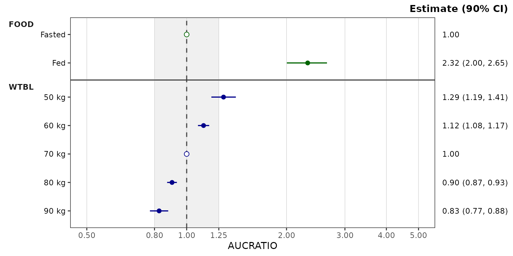
Reference rows (here the `Fasted` and `70 kg` copies) draw as an open
circle through the `ref_point` style role and show the estimate alone in
the right-hand column.

The reference can instead be drawn in a reference panel at the top with
`ref_layout = "consolidated"`, from the same `forest_obj`. Without
`cov_level_ref`, the reference panel is always used.

``` r

plot_forest(forest_obj,
            metric = "AUCRATIO", ref_layout = "consolidated",
            ref_band = c(0.8, 1.25), style = new_forest_style) +
  scale_x_log10(limits = c(0.5, 5), breaks = c(0.5, 0.8, 1, 1.25, 2, 3, 4, 5))
```

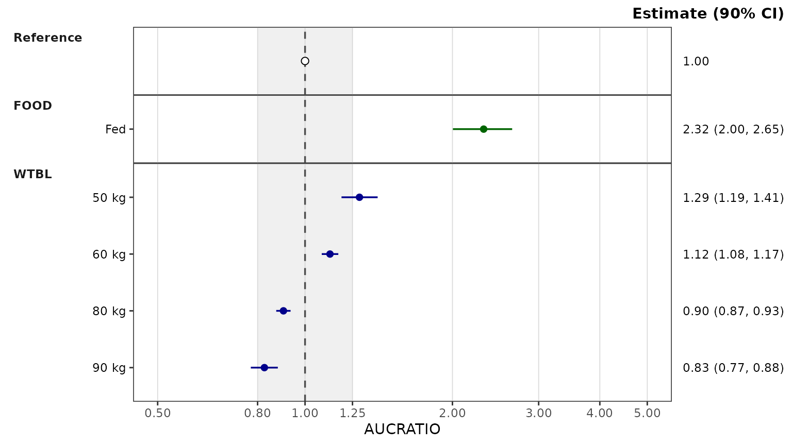

## Plot themes with `ggstylekit`

`pmxhelpr` leverages the functionality of the `ggstylekit` package to
control the styling of plot elements.

Every `plot_*()` function ships with a companion `style_*()` helper
function that returns a
[`ggstylekit::style_spec()`](https://rdrr.io/pkg/ggstylekit/man/style_spec.html)
object pre-filled with the defaults. The defaults styling for each plot
type can be visualized by calling the function with no arguments

``` r

style_dvtime()
#> <ggstylekit_style_spec>
#>   colors                 NULL
#>   fill                   NULL
#>   linetypes              solid , solid , dashed, dashed
#>   alphas                 0.5, 0.5, 0.0, 1.0, 1.0, 1.0, 1.0
#>   shapes                  1, 16
#>   sizes                  0.75, 1.25
#>   linewidths             0.50, 0.75, 0.75, 0.50, 0.50
#>   point_color            NULL
#>   point_alpha            NULL
#>   point_size             NULL
#>   point_shape            NULL
#>   line_color             NULL
#>   line_alpha             NULL
#>   line_linetype          NULL
#>   line_linewidth         NULL
#>   line_fill              NULL
#>   errorbar_color         NULL
#>   errorbar_alpha         NULL
#>   errorbar_linetype      NULL
#>   errorbar_linewidth     NULL
#>   errorbar_width         NULL
#>   errorbar_fill          NULL
#>   bar_fill               NULL
#>   bar_color              NULL
#>   bar_alpha              NULL
#>   bar_linewidth          NULL
#>   area_fill              NULL
#>   area_color             NULL
#>   area_alpha             NULL
#>   area_linewidth         NULL
#>   box_fill               NULL
#>   box_color              NULL
#>   box_alpha              NULL
#>   box_linewidth          NULL
#>   title                  NULL
#>   xlabel                 NULL
#>   ylabel                 NULL
#>   caption                NULL
#>   xlims                  NULL
#>   ylims                  NULL
#>   logx                   NULL
#>   logy                   NULL
#>   xbreaks                NULL
#>   ybreaks                NULL
#>   xminor_breaks          NULL
#>   yminor_breaks          NULL
#>   xtick_labels           NULL
#>   ytick_labels           NULL
#>   xorder                 NULL
#>   yorder                 NULL
#>   equal_axis             NULL
#>   legends                NULL
#>   legend.position        NULL
#>   legend.title.position  top
#>   legend_nrow            NULL
#>   legend_ncol            NULL
#>   legend.title.hjust     NULL
#>   caption_hjust          NULL
#>   fill_alpha             NULL
#>   facet                  NULL
#>   facet_scales           NULL
#>   facet_nrow             NULL
#>   facet_ncol             NULL
#>   theme                  <ggplot2 theme>
```

Each aesthetic map (`colors`, `shapes`, `sizes`, `linetypes`,
`linewidths`, `alphas`) is keyed by *role* (e.g. `obs_point`,
`cent_line`, `cent_errorbar`, `ref_line`, `loq_line`). Partial overrides
merge onto the defaults, so setting one role leaves the others
untouched.

New styles can be defined as an object and recycled across plots. This
revised style object increases the linewidth of the central tendency
line and error bars. Observed points are hidden with the
`show_obs = FALSE` argument, which omits the layer so it does not affect
the axis limits.

``` r

new_dvtime_style <- style_dvtime(
    linewidths = c(cent_line = 1.5, cent_errorbar = 1.5)
  )
new_dvtime_style
#> <ggstylekit_style_spec>
#>   colors                 NULL
#>   fill                   NULL
#>   linetypes              solid , solid , dashed, dashed
#>   alphas                 0.5, 0.5, 0.0, 1.0, 1.0, 1.0, 1.0
#>   shapes                  1, 16
#>   sizes                  0.75, 1.25
#>   linewidths             0.5, 1.5, 1.5, 0.5, 0.5
#>   point_color            NULL
#>   point_alpha            NULL
#>   point_size             NULL
#>   point_shape            NULL
#>   line_color             NULL
#>   line_alpha             NULL
#>   line_linetype          NULL
#>   line_linewidth         NULL
#>   line_fill              NULL
#>   errorbar_color         NULL
#>   errorbar_alpha         NULL
#>   errorbar_linetype      NULL
#>   errorbar_linewidth     NULL
#>   errorbar_width         NULL
#>   errorbar_fill          NULL
#>   bar_fill               NULL
#>   bar_color              NULL
#>   bar_alpha              NULL
#>   bar_linewidth          NULL
#>   area_fill              NULL
#>   area_color             NULL
#>   area_alpha             NULL
#>   area_linewidth         NULL
#>   box_fill               NULL
#>   box_color              NULL
#>   box_alpha              NULL
#>   box_linewidth          NULL
#>   title                  NULL
#>   xlabel                 NULL
#>   ylabel                 NULL
#>   caption                NULL
#>   xlims                  NULL
#>   ylims                  NULL
#>   logx                   NULL
#>   logy                   NULL
#>   xbreaks                NULL
#>   ybreaks                NULL
#>   xminor_breaks          NULL
#>   yminor_breaks          NULL
#>   xtick_labels           NULL
#>   ytick_labels           NULL
#>   xorder                 NULL
#>   yorder                 NULL
#>   equal_axis             NULL
#>   legends                NULL
#>   legend.position        NULL
#>   legend.title.position  top
#>   legend_nrow            NULL
#>   legend_ncol            NULL
#>   legend.title.hjust     NULL
#>   caption_hjust          NULL
#>   fill_alpha             NULL
#>   facet                  NULL
#>   facet_scales           NULL
#>   facet_nrow             NULL
#>   facet_ncol             NULL
#>   theme                  <ggplot2 theme>
```

``` r

plot_dvtime(
  data = data_pk,
  dv_var = ODV,
  cent = "mean_sdl",
  col_var = "Regimen",
  log_y = TRUE,
  show_obs = FALSE,
  style = new_dvtime_style
) +
  labs(y = "Concentration (ng/mL)", x = "Time (hours)")
```

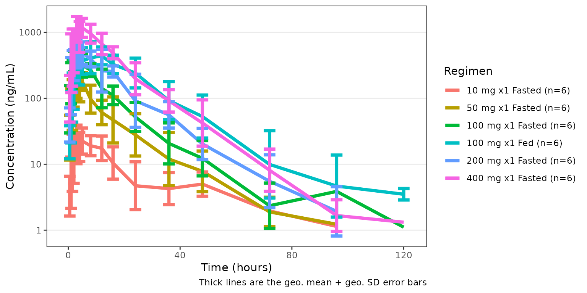

Variables can also be surfaced and mapped to aesthetics after the fact
with [`reveal()`](https://rdrr.io/pkg/ggstylekit/man/reveal.html),
re-exported from ggstylekit.

See the [Plot Styling and
Aesthetics](https://ryancrass.github.io/pmxhelpr/articles/plot-styling.md)
article for additional details on plot styling with `pmxhelpr`.

## Where to go next

- [Exploratory Analyses of PK and PK/PD
  Data](https://ryancrass.github.io/pmxhelpr/articles/eda-pk-pkpd-workflow.md)
- [Dose-Proportionality
  Workflow](https://ryancrass.github.io/pmxhelpr/articles/doseprop-workflow.md)
- [Goodness-of-Fit
  Diagnostics](https://ryancrass.github.io/pmxhelpr/articles/gof-diagnostics.md)
- [Visual Predictive Check
  Workflow](https://ryancrass.github.io/pmxhelpr/articles/vpc-workflow.md)
- [Plot Styling and
  Aesthetics](https://ryancrass.github.io/pmxhelpr/articles/plot-styling.md)
